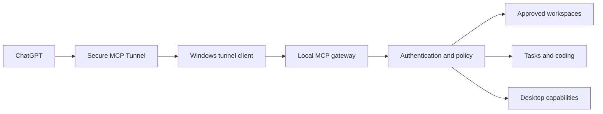
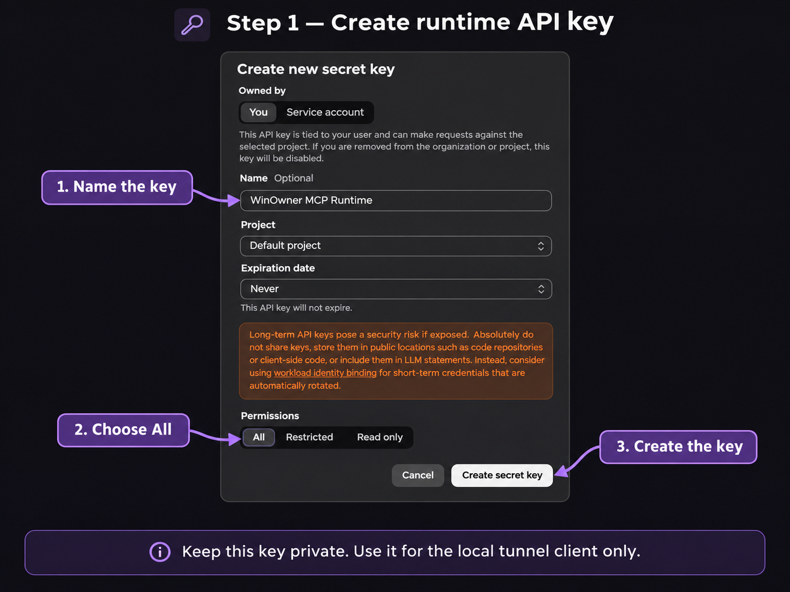
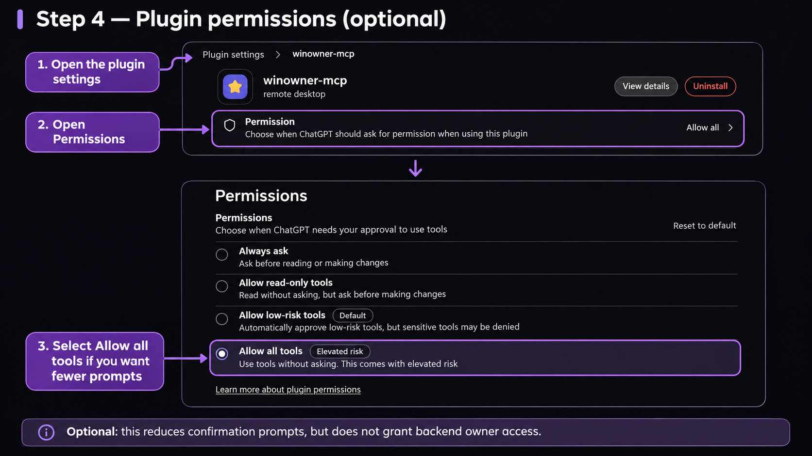

<div align="center">

# WinOwner MCP v1.2.0

**Your Windows workspace, available in ChatGPT.**

An open-source Windows MCP gateway for authorized workspace inspection, scoped development workflows, and task management.

Windows 10/11 · Model Context Protocol · MIT

**English** | [Tiếng Việt](README.vi.md)

[Overview](#overview) · [Features](#key-features) · [Architecture](#architecture) · [Quick Start](#quick-start) · [34 Tools](docs/CAPABILITIES.md) · [Security & Permissions](#security--permissions) · [Troubleshooting](#troubleshooting)

</div>

## Overview

WinOwner MCP connects your own Windows workstation to ChatGPT over an authenticated private tunnel, rather than moving your files to a cloud VM. The local MCP gateway stays bound to loopback (`127.0.0.1:8768`), checks authentication and policy on every call, defaults to `read_only`, and keeps Windows NTFS ACLs and user-session boundaries intact.

## Key features

| Feature | What it delivers |
|---|---|
| Windows-first onboarding | Single-command install (`go.ps1`) or extracted ZIP launcher (`Install-WinOwner.cmd`) with automated local health and auth verification |
| Workspace & Git inspection | Inspect approved directories, read text files, and review `git status` or `git diff` |
| Scoped coding workflow | File modifications, test runs, and command execution only within explicitly authorized scopes |
| Task lifecycle management | Background task status, logs, diffs, and artifacts; owner-verified pause, resume, cancel, and emergency stop |
| Desktop capability boundary | Window observation, screenshots, and UI input strictly gated by owner identity, policy, and interactive session rules |
| Connection lifecycle tools | Local diagnostics (`Check-WinOwner.cmd`), tunnel management (`Connect-ChatGPT.cmd`, `Disconnect-ChatGPT.cmd`), and clean uninstall |

## Architecture



- The local gateway binds to `127.0.0.1` only and is never intended to be exposed directly on public interfaces.
- Connectivity uses an outbound HTTPS tunnel via the official OpenAI `tunnel-client` (downloaded and SHA-256 verified during `Connect-ChatGPT.cmd`).
- WinOwner runs under your standard Windows user session and never elevates Windows privileges or bypasses NTFS/UAC.

## System requirements

- Windows 10 or Windows 11 (x64) with Windows PowerShell 5.1.
- Python 3.12 (the installer can install it via `winget` where available, or you can install from python.org).
- Outbound Internet access plus an eligible ChatGPT account/workspace allowed to add custom MCP servers and OpenAI Platform permissions to create a Runtime API key and Tunnel.
- An active Windows user session for local services; interactive desktop tools require an unlocked interactive desktop session.

## Quick Start

### Install locally

> The `v1.2.0` tag and archive are not yet published. Only run the one-line installer after verifying `v1.2.0` is available under [GitHub Releases](https://github.com/phuonghuster7/winowner-mcp/releases).

Open Windows Command Prompt (**CMD**) when `v1.2.0` is published (or extract the verified release ZIP and double-click `Install-WinOwner.cmd`):

```cmd
powershell -NoP -C "irm https://github.com/phuonghuster7/winowner-mcp/raw/v1.2.0/go.ps1|iex"
```

By default, WinOwner installs into `%LOCALAPPDATA%\WinOwnerMCP\v1.2.0` in `read_only` mode, creates dependencies in an isolated `.venv`, registers a per-user Task Scheduler startup task, and verifies local `/health` and anonymous HTTP `401` enforcement (`LOCAL_INSTALL_PASS`).

### Connect to ChatGPT

Use an approved OpenAI organization and ChatGPT workspace. The four illustrated UI guides below use example identifiers (`tunnel_1234...`), not real account credentials.

#### Step 1 · Create a Runtime API key

[OpenAI API keys](https://platform.openai.com/settings/organization/api-keys) · [Official Secure MCP Tunnels guide](https://developers.openai.com/api/docs/guides/secure-mcp-tunnels)



1. **Name the key:** enter a recognizable name such as `WinOwner MCP Runtime`.
2. **Review permissions (important):** although the UI example highlights `All`, **do not grant full API permissions (`All`) by default** if your organization supports `Restricted` tunnel-scoped permissions—select the minimum permissions required for the tunnel and never use an organization admin key for the runtime daemon.
3. **Create the key:** click **Create secret key** and keep it private (use it for the local `tunnel-client` only; never paste the key in chat messages, Git commits, or screenshots).

#### Step 2 · Create a Private Tunnel

[OpenAI Tunnels](https://platform.openai.com/settings/organization/tunnels) · [Official tunnel-client end-user guide](https://github.com/openai/tunnel-client/blob/master/docs/end-user-guide.md)


1. **Name the tunnel:** enter a name such as `winowner-mcp` and a short description such as `WinOwner MCP`.
2. **Select organization and workspace:** choose the authorized OpenAI organization and matching ChatGPT workspace (for personal/single-org setups, your default organization and workspace).
3. **Create the tunnel:** click **Create**, then copy the generated `Tunnel ID` (`tunnel_...`).

Next, run `Connect-ChatGPT.cmd` in `%LOCALAPPDATA%\WinOwnerMCP\v1.2.0` and enter your Runtime API key (hidden prompt) and `Tunnel ID`. The runtime key authenticates `tunnel-client`; the `Tunnel ID` identifies the tunnel endpoint.

#### Step 3 · Create the ChatGPT Plugin

[ChatGPT plugins](https://chatgpt.com/plugins) · [Official Secure MCP Tunnels guide](https://developers.openai.com/api/docs/guides/secure-mcp-tunnels) · [About Authentication None (Vietnamese)](docs/AUTH_NONE.vi.md)


1. **Open the custom connector dialog:** click **Add > Add custom MCP server** on the ChatGPT Plugins page.
2. **Enter plugin details:** enter `winowner-mcp` and an optional short description (e.g., `remote desktop`).
3. **Select Tunnel & paste the ID:** switch **Connection** to **Tunnel** and paste your `Tunnel ID` from Step 2.
4. **Authentication & confirmation:** select `No authentication` only when WinOwner enforces authentication and policy at its private tunnel and local backend (this never bypasses backend HTTP `401` checks or grants owner access). Read the trust warning, check **I understand and want to continue**, and click **Create as a plugin**. Keep initial access `read_only`.

#### Step 4 · Plugin Permissions (optional)

[Managing app permissions in ChatGPT](https://help.openai.com/en/articles/20001495-managing-app-permissions-in-chatgpt)



This step is **optional and not required to connect**.

1. **Open the plugin settings:** go to `Plugin settings > winowner-mcp`.
2. **Open Permissions:** choose when ChatGPT asks for approval before calling a tool (`Always ask`, `Allow read-only tools`, `Allow low-risk tools`, or `Allow all tools`).
3. **Prefer confirmations for sensitive tools:** keep confirmation enabled (`Allow read-only tools` or `Allow low-risk tools`) for state-changing actions. While the diagram shows selecting `Allow all tools` for fewer prompts, that setting carries **elevated risk** and **does not grant backend owner access**.

**ChatGPT approval vs. backend permissions:** ChatGPT approval settings only control UI confirmation prompts. The WinOwner backend and Windows OS independently check identity, OAuth owner delegation, capability grants, and workspace policy on every request. Selecting `Allow all tools` never bypasses backend checks.

### Verify the connection

| Check | Scope verified |
|---|---|
| `LOCAL_INSTALL_PASS` / `CHECK_PASS` | Local MCP service health and anonymous HTTP `401` blocking |
| `TUNNEL_SETUP_PASS` / `TUNNEL_READY` | Local `tunnel-client` task running and `/readyz` responding |
| Successful read-only request in ChatGPT | End-to-end tool execution for that ChatGPT workspace and request |

These three checks are independent. Confirm end-to-end connectivity with a harmless read-only request against an approved test workspace before enabling any write or owner capability.

## Usage examples

Try non-destructive read-only prompts in an approved test workspace first:

- `"List my approved workspaces."`
- `"Summarize Git status for my approved project without modifying any files."`
- `"Show the status of my existing task."`

Illustrative read-only response structure:

```text
Approved workspaces:
- D:\SampleWorkspace (read_only)

Git status summary:
- branch: feat/example
- modified files: 0
- untracked files: 0

Task status:
- no active mutating tasks
```

*Illustrative example only: synthetic output for documentation clarity, not a live acceptance recording.*

## Capabilities — 34 tools

The cloud catalog defines **14 baseline tools** and **20 additional owner-catalog tools** (**34 catalog entries total**). WinOwner defaults to `read_only`; a tool appearing in the catalog does not authorize execution.

| Capability group | Baseline | Owner catalog | Access & safety boundary |
|---|---:|---:|---|
| Workspace & Git inspection | 4 | 0 | Read approved workspace paths and Git metadata |
| File & directory changes | 2 | 6 | Scoped edits (`read_only` blocked unless write/owner grants apply) |
| Coding & test execution | 2 | 0 | Explicit execution authorization; not an OS sandbox |
| Task submission & monitoring | 6 | 0 | Task submission does not authorize unattended execution |
| Task lifecycle control | 0 | 4 | Pause, resume, cancel, and emergency stop require owner auth |
| Desktop observation & interaction | 0 | 9 | Owner-verified; interactive session and policy restrictions apply |
| System execution | 0 | 1 | `agent_powershell_execute`; strict owner authorization & Windows ACLs |
| **Total** | **14** | **20** | **34 catalog entries — not 34 pre-authorized actions** |

See the complete identifier list and permission tiers in [docs/CAPABILITIES.md](docs/CAPABILITIES.md).

## Security & Permissions

WinOwner separates controls into three independent layers:

1. **ChatGPT plugin approvals (UI layer):** configures when ChatGPT asks for user confirmation (`Always ask`, `Allow read-only tools`, or `Allow all tools`). Optional, and never authoritative on the host.
2. **WinOwner backend authorization (gateway layer):** requires authenticated caller/tunnel credentials, enforces `read_only` by default, isolates OAuth owner pairing (`Grant-OwnerAccess.cmd`) from shared tunnel credentials, and validates path/workspace scopes and capability grants on every tool call.
3. **Windows host controls (OS layer):** runs under your unprivileged Windows user account; standard Windows NTFS permissions and UAC continue to apply.

Local management utilities in `%LOCALAPPDATA%\WinOwnerMCP\v1.2.0`:

- `Check-WinOwner.cmd`: verify local service health, anonymous `401` enforcement, and local tunnel readiness.
- `Disconnect-ChatGPT.cmd`: stop and unregister only the verified local tunnel task while leaving local install/auth intact.
- `Uninstall-WinOwner.cmd`: stop and remove verified local service and tunnel tasks cleanly.
- [Advanced owner administration (Vietnamese)](docs/ADVANCED_CHATGPT.vi.md): `Grant-OwnerAccess.cmd`, `Show-OwnerKey.cmd`, and `Revoke-OwnerAccess.cmd` are explicit administrative tools kept separate from initial setup.

See [SECURITY.md](SECURITY.md), [docs/INSTALLATION.md](docs/INSTALLATION.md), and [docs/START_HERE.vi.md](docs/START_HERE.vi.md).

## Troubleshooting

| Symptom | Recommended check |
|---|---|
| Local install fails | Review `WinOwner-SETUP-RESULT.txt` and rerun `Check-WinOwner.cmd`; verify Python 3.12 and port `8768` availability |
| HTTP `401` / unauthorized | Ensure you ran `Connect-ChatGPT.cmd` with a valid Runtime API key and Tunnel ID; do not disable backend auth |
| Tunnel not ready or `429` | Inspect `tunnel-client` status and network/rate-limit state via `Check-WinOwner.cmd` |
| Tool call denied | Confirm workspace scope, `read_only` vs. owner grant state; do not weaken authentication |
| Need to stop immediately | Disconnect with `Disconnect-ChatGPT.cmd` or trigger the emergency stop and revoke grants separately |

Detailed recovery steps are documented in [docs/TROUBLESHOOTING.md](docs/TROUBLESHOOTING.md).

## License

Released under the [MIT License](LICENSE).

- [GitHub Releases](https://github.com/phuonghuster7/winowner-mcp/releases) · [CI Runs](https://github.com/phuonghuster7/winowner-mcp/actions) · [Contributing](CONTRIBUTING.md)
- Automated CI validates source hygiene, static security checks, packaging, and local dry-runs; it does not establish live ChatGPT pairing, compatibility on every machine, or a security certification.
- Independent open-source project; not affiliated with OpenAI or Microsoft.
