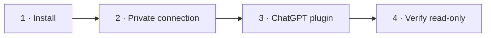

# WinOwner MCP v1.2.0

Connect your own Windows 10/11 computer to ChatGPT for approved, read-only tasks.

[Tiếng Việt](README.vi.md) · [Technical documentation](docs/CONNECT_CHATGPT.md)



## 1 · Install
Check [Releases](https://github.com/phuonghuster7/winowner-mcp/releases) first. The command below requires the v1.2.0 release tag; review the installer before running it in CMD.
```cmd
powershell -NoP -C "irm https://github.com/phuonghuster7/winowner-mcp/raw/v1.2.0/go.ps1|iex"
```
The install folder is `%LOCALAPPDATA%\WinOwnerMCP\v1.2.0`. Open it and run `Check-WinOwner.cmd`.

## 2 · Private connection
Use your authorized organization's [official Secure MCP Tunnel guide](https://developers.openai.com/api/docs/guides/secure-mcp-tunnels). The two values are a **Tunnel ID** and a **runtime API key**, not two API keys. The existing local setup utility is `Connect-ChatGPT.cmd`. Do not share keys.

## 3 · ChatGPT plugin
Follow the [official custom MCP server guide](https://developers.openai.com/api/docs/guides/custom-mcp-server). Review the requested access and keep the initial connection read-only. Authentication settings alone do not establish owner identity.

## 4 · Check that it works
Local check passed ≠ tunnel ready ≠ ChatGPT connected. Confirm with a harmless read-only test. Do not enable access you do not need.

## Capabilities & permissions

The cloud catalog contains **14 baseline tools, up to 34 for eligible owner sessions**. Read-only by default; listing a tool does not authorize execution.

| Area | Boundary |
|---|---|
| Files, workspaces, Git | Approved reads; separate write authorization |
| Coding and tests | Separate execution authorization |
| Tasks | Authorized monitoring and control |
| Desktop and system | Sensitive access; separate identity and authorization |

[All 34 tool identifiers and permission model](docs/CAPABILITIES.md).

## Manage
- `Disconnect-ChatGPT.cmd`: disconnect the verified local tunnel.
- `Uninstall-WinOwner.cmd`: stop/remove the verified service and tunnel.
- [Advanced administration](docs/ADVANCED_CHATGPT.vi.md): Grant-OwnerAccess and other sensitive administrative facilities are not part of initial setup. Revocation and owner pairing need separate verification.

[Installation and repair](docs/INSTALLATION.md) · [Security](SECURITY.md) · [Quick guide](docs/START_HERE.vi.md)

MIT licensed; independent of OpenAI and Microsoft.
