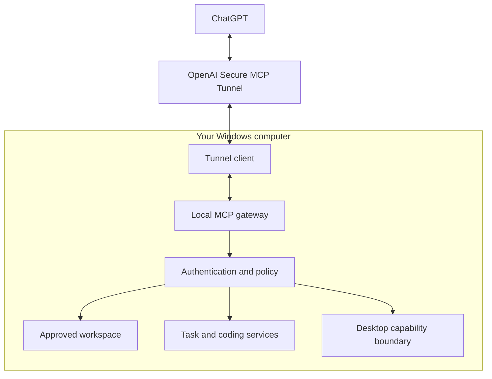
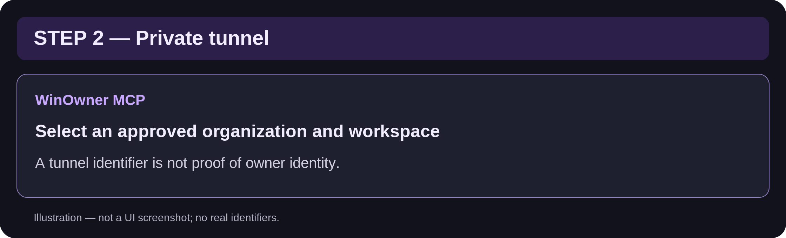
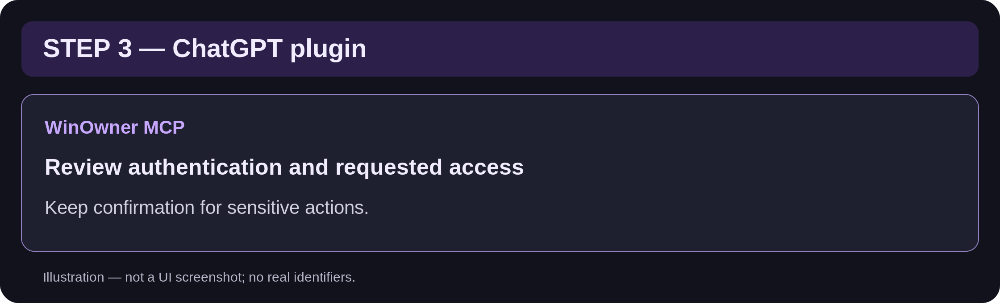
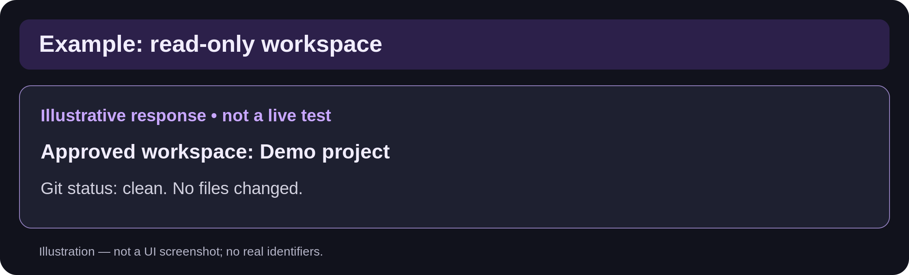

<div align="center">

# WinOwner MCP v1.2.0

**Your Windows workspace, available in ChatGPT.**

An open-source Windows MCP gateway for authorized workspace inspection, development workflows, and task management.

Windows 10/11 · Model Context Protocol · MIT

**English** | [Tiếng Việt](README.vi.md)

[Get started](#quick-start) · [Features](#features) · [Architecture](#architecture) · [Tool catalog](docs/CAPABILITIES.md) · [Troubleshooting](docs/TROUBLESHOOTING.md)

</div>

## Why WinOwner?

WinOwner runs on your own Windows computer rather than replacing your workspace with a cloud VM. The connection is private; the server applies its own authentication and permission policy. Access is read-only by default, with separate authorization for sensitive operations.

## Features

| Feature | What it means |
|---|---|
| Windows-first setup | One-command local installation with automatic health and authentication checks |
| Workspace awareness | Inspect approved directories, text files and Git status or diffs |
| Coding workflow | Scoped editing and test capabilities where explicitly authorized |
| Task lifecycle | Task status, logs, diffs and artifacts; separate authorization for task control |
| Desktop integration | Desktop capabilities in the owner catalog, subject to identity, policy and session restrictions |
| Connection lifecycle | Local checks, tunnel disconnection and uninstall utilities |

## Architecture



The local gateway is not intended to be exposed publicly. The tunnel requires outbound HTTPS; Windows must be running and the relevant services available. The gateway does not elevate Windows privileges.

## Requirements

- Windows 10/11 x64 and Windows PowerShell 5.1.
- Python 3.12; the setup can install it with winget where available.
- Internet access and an eligible ChatGPT account/workspace permitted to add custom MCP servers; separate Platform tunnel permissions apply.
- A Windows user session for local services; interactive desktop features have additional session requirements.

## Quick start

### Install locally
Open Windows Command Prompt (CMD) when the matching release is available.
```cmd
powershell -NoP -C "irm https://github.com/phuonghuster7/winowner-mcp/raw/v1.2.0/go.ps1|iex"
```
The installer automatically verifies local health and authentication.

> The v1.2.0 release is not yet published. [Release downloads](https://github.com/phuonghuster7/winowner-mcp/releases).

### Connect to ChatGPT

Use an approved organization and workspace. The diagrams below are illustrations, not screenshots of the OpenAI interface.

#### 1 · Runtime API key

[OpenAI API keys](https://platform.openai.com/settings/organization/api-keys) · [Official tunnel requirements](https://developers.openai.com/api/docs/guides/secure-mcp-tunnels)


#### 2 · Private tunnel

[OpenAI Tunnels](https://platform.openai.com/settings/organization/tunnels) · [Official interface reference](https://github.com/openai/tunnel-client/blob/master/docs/end-user-guide.md)



The local connection utility is `Connect-ChatGPT.cmd`. The runtime key authenticates the tunnel client, while the Tunnel ID identifies the connection. Never share the key in chat or screenshots.

#### 3 · ChatGPT plugin

[ChatGPT plugins](https://chatgpt.com/plugins) · [Official connection guide](https://developers.openai.com/api/docs/guides/secure-mcp-tunnels)



Authentication settings must match the verified server configuration. Keep the initial access read-only; tunnel access does not establish owner identity.

#### 4 · Plugin permissions (optional)

Review the available approval settings. `Allow all tools` reduces confirmation prompts, carries elevated risk and does not grant owner access. Prefer confirmation for sensitive actions. [Permission reference](https://help.openai.com/en/articles/20001495-managing-app-permissions-in-chatgpt).

### Verify the connection

| Result | What is verified |
|---|---|
| `LOCAL_INSTALL_PASS` / `CHECK_PASS` | Local service and authentication checks |
| `TUNNEL_SETUP_PASS` / `TUNNEL_READY` | Local tunnel readiness |
| Successful read-only request | Actual ChatGPT connection for that request |

These checks are distinct. Confirm using a harmless read-only request against an approved test workspace.

## Example prompts

Try read-only requests in an approved test workspace after connection:

- "List my approved workspaces."
- "Summarize Git status for my approved project without changing anything."
- "Show the status of my existing task."



*Example only: this is synthetic documentation, not a recording or a successful live acceptance test.*

## Capabilities & permissions

The cloud catalog contains **14 baseline tools, up to 34 for eligible owner sessions**. Read-only by default; listing a tool does not authorize execution.

| Capability | Baseline catalog | Additional owner catalog | Access boundary |
|---|---:|---:|---|
| Workspace and Git inspection | 4 | 0 | Approved reads |
| File and directory changes | 2 | 6 | Scoped writes; owner checks for additional tools |
| Coding and tests | 2 | 0 | Separate execution authorization |
| Task submission and monitoring | 6 | 0 | Submission does not authorize execution |
| Task control | 0 | 4 | Verified owner authorization |
| Desktop observation and interaction | 0 | 9 | Verified owner; interactive session and policy restrictions |
| System execution | 0 | 1 | Separate authorization and Windows access boundaries |
| **Total** | **14** | **20** | **34 catalog entries, not 34 pre-authorized actions** |

[All 34 tool identifiers and permission model](docs/CAPABILITIES.md).

## Security and lifecycle

The server defaults to read-only. A listed tool is not necessarily authorized to execute. Tunnel credentials are not proof of owner identity. Windows access controls still apply, and privileged execution is not an OS sandbox. See [Security](SECURITY.md) and the [permission model](docs/CAPABILITIES.md).

## Manage

- `Disconnect-ChatGPT.cmd`: disconnect the verified local tunnel.
- `Uninstall-WinOwner.cmd`: stop/remove the verified service and tunnel.
- [Advanced administration](docs/ADVANCED_CHATGPT.vi.md): Grant-OwnerAccess and other sensitive administrative facilities are not part of initial setup. Revocation and owner pairing need separate verification.

For troubleshooting only, use `Check-WinOwner.cmd` in `%LOCALAPPDATA%\WinOwnerMCP\v1.2.0`.

[Installation and repair](docs/INSTALLATION.md) · [Security](SECURITY.md) · [Vietnamese quick guide](docs/START_HERE.vi.md)

## Troubleshooting

| Symptom | Check |
|---|---|
| Local install fails | Review the installer result and local diagnostic output |
| Tunnel unavailable | Check connection status and account/workspace eligibility |
| Tool call denied | Check the authorized scope; do not weaken authentication |
| Need to disconnect | Use the local disconnect utility and review remote access separately |

See [Troubleshooting](docs/TROUBLESHOOTING.md) for details.

## Project links

[Releases](https://github.com/phuonghuster7/winowner-mcp/releases) · [CI history](https://github.com/phuonghuster7/winowner-mcp/actions) · [Contributing](CONTRIBUTING.md) · [License](LICENSE)

CI does not establish live ChatGPT pairing, compatibility on every machine or a security certification.

MIT licensed; independent of OpenAI and Microsoft.
