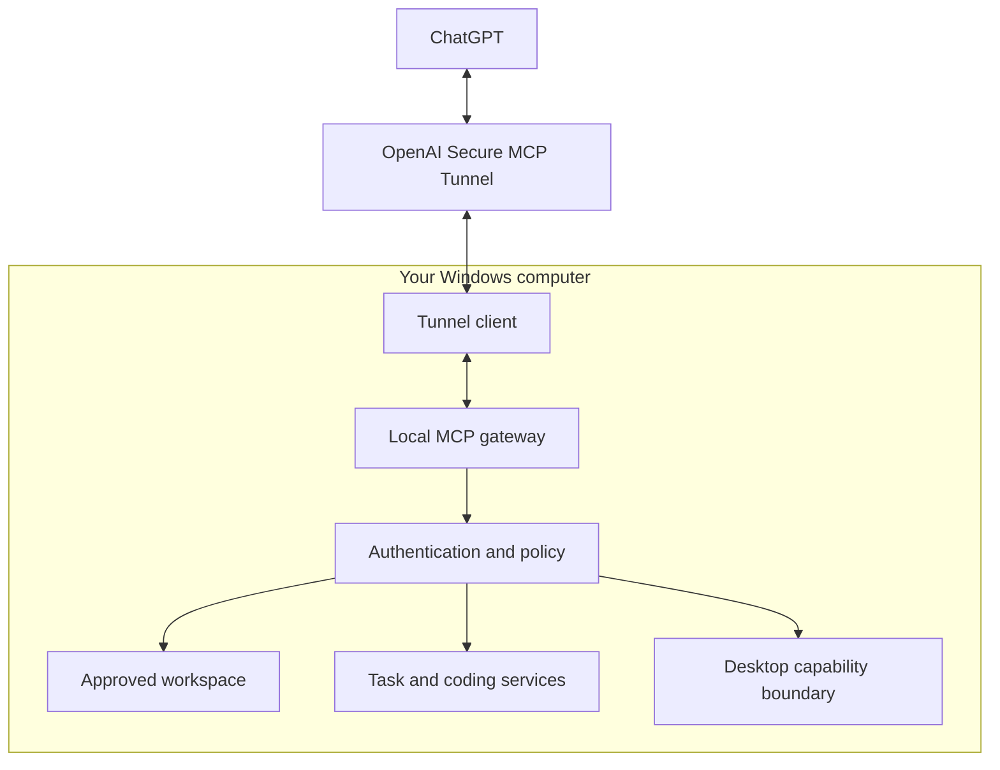

<div align="center">

# WinOwner MCP v1.2.0

**Your Windows workspace, available in ChatGPT.**

An open-source Windows MCP gateway for authorized workspace inspection, development workflows, and task management.

Windows 10/11 · Model Context Protocol · MIT

**English** | [Tiếng Việt](README.vi.md)

[Get started](#quick-start) · [Features](#features) · [Architecture](#architecture) · [Tool catalog](docs/CAPABILITIES.md) · [Troubleshooting](docs/TROUBLESHOOTING.md)

</div>

## Why WinOwner?

WinOwner runs on your own Windows computer rather than replacing your workspace with a cloud VM. The connection is private; the server applies its own authentication and permission policy. Access is read-only by default, with separate authorization for sensitive operations.

## Features

| Feature | What it means |
|---|---|
| Windows-first setup | One-command local installation with automatic health and authentication checks |
| Workspace awareness | Inspect approved directories, text files and Git status or diffs |
| Coding workflow | Scoped editing and test capabilities where explicitly authorized |
| Task lifecycle | Task status, logs, diffs and artifacts; separate authorization for task control |
| Desktop integration | Desktop capabilities in the owner catalog, subject to identity, policy and session restrictions |
| Connection lifecycle | Local checks, tunnel disconnection and uninstall utilities |

## Architecture



The local gateway is not intended to be exposed publicly. The tunnel requires outbound HTTPS; Windows must be running and the relevant services available. The gateway does not elevate Windows privileges.

## Requirements

- Windows 10/11 x64 and Windows PowerShell 5.1.
- Python 3.12; the setup can install it with winget where available.
- Internet access and an eligible ChatGPT account/workspace permitted to add custom MCP servers; separate Platform tunnel permissions apply.
- A Windows user session for local services; interactive desktop features have additional session requirements.

## Quick start

### 1 · Install
Open Windows Command Prompt (CMD). For a published v1.2.0 release, the installation command is:
```cmd
powershell -NoP -C "irm https://github.com/phuonghuster7/winowner-mcp/raw/v1.2.0/go.ps1|iex"
```
The installer automatically checks local health and authentication. A successful installation does not require a second manual check.

> Release availability: the v1.2.0 tag must be published before this command works. [Release downloads](https://github.com/phuonghuster7/winowner-mcp/releases).

### 2 · Prepare the private connection

For an authorized read-only setup, use the following official screens. Choose the organization and workspace you are permitted to use.

**A. Tunnel ID** — [Open Tunnels](https://platform.openai.com/settings/organization/tunnels). Select **Create tunnel** and use the intended organization/workspace. The identifier is displayed in the tunnel list.

[](https://raw.githubusercontent.com/openai/tunnel-client/master/docs/images/tunnel-create-modal.png)

*Source: [OpenAI tunnel-client guide](https://github.com/openai/tunnel-client/blob/master/docs/end-user-guide.md).*

**B. Runtime API key** — [Open API keys](https://platform.openai.com/settings/organization/api-keys). Select **Create new secret key**; use a restricted key with the required tunnel permissions, not an admin key. See the [official permission requirements](https://developers.openai.com/api/docs/guides/secure-mcp-tunnels).

[](https://images.ctfassets.net/j22is2dtoxu1/intercom-img-31e55bc83cf1bbb71a5c8c5e/03b55611063f104024f3d50a6a875625/Frame_13.png)

*Source: [OpenAI Help Center](https://help.openai.com/en/articles/9186755-managing-projects-in-the-api-platform). This example shows Restricted, not the tunnel-specific permission fields.*

The local setup utility is `Connect-ChatGPT.cmd`. Keep the key private and do not include it in screenshots or chat.

### 3 · Add a private ChatGPT plugin

Open [ChatGPT](https://chatgpt.com/#settings/Connectors) and locate **Plugins → Add custom MCP server** for an account/workspace with permission. The official interface below shows the **Tunnel** connection selector. Review its authentication requirements and requested access, and retain the read-only setup.

[](https://raw.githubusercontent.com/openai/tunnel-client/master/docs/images/chatgpt-connector-tunnel-select.png)

*Source: [OpenAI tunnel-client guide](https://github.com/openai/tunnel-client/blob/master/docs/end-user-guide.md). This screenshot shows OAuth; the interface and available authentication methods can vary. Authentication settings do not establish owner identity.*

[Official plugin setup reference](https://developers.openai.com/api/docs/guides/secure-mcp-tunnels)

### 4 · Check that it works
Local check passed ≠ tunnel ready ≠ ChatGPT connected. Confirm with a harmless read-only test. Do not enable access you do not need.

## Example prompts

Try read-only requests in an approved test workspace after connection:

- "List my approved workspaces."
- "Summarize Git status for my approved project without changing anything."
- "Show the status of my existing task."

These are example requests, not screenshots or claims of live acceptance testing.

## Capabilities & permissions

The cloud catalog contains **14 baseline tools, up to 34 for eligible owner sessions**. Read-only by default; listing a tool does not authorize execution.

| Area | Boundary |
|---|---|
| Files, workspaces, Git | Approved reads; separate write authorization |
| Coding and tests | Separate execution authorization |
| Tasks | Authorized monitoring and control |
| Desktop and system | Sensitive access; separate identity and authorization |

[All 34 tool identifiers and permission model](docs/CAPABILITIES.md).

## Security and lifecycle

The server defaults to read-only. A listed tool is not necessarily authorized to execute. Tunnel credentials are not proof of owner identity. Windows access controls still apply, and privileged execution is not an OS sandbox. See [Security](SECURITY.md) and the [permission model](docs/CAPABILITIES.md).

## Manage
- `Disconnect-ChatGPT.cmd`: disconnect the verified local tunnel.
- `Uninstall-WinOwner.cmd`: stop/remove the verified service and tunnel.
- [Advanced administration](docs/ADVANCED_CHATGPT.vi.md): Grant-OwnerAccess and other sensitive administrative facilities are not part of initial setup. Revocation and owner pairing need separate verification.

For troubleshooting only, use `Check-WinOwner.cmd` in `%LOCALAPPDATA%\WinOwnerMCP\v1.2.0`.

[Installation and repair](docs/INSTALLATION.md) · [Security](SECURITY.md) · [Quick guide](docs/START_HERE.vi.md)

## Troubleshooting

| Symptom | Check |
|---|---|
| Local install fails | Review the installer result and local diagnostic output |
| Tunnel unavailable | Check connection status and account/workspace eligibility |
| Tool call denied | Check the authorized scope; do not weaken authentication |
| Need to disconnect | Use the local disconnect utility and review remote access separately |

See [Troubleshooting](docs/TROUBLESHOOTING.md) for details.

## Project links

[Releases](https://github.com/phuonghuster7/winowner-mcp/releases) · [CI history](https://github.com/phuonghuster7/winowner-mcp/actions) · [Contributing](CONTRIBUTING.md) · [License](LICENSE)

CI does not establish live ChatGPT pairing, compatibility on every machine or a security certification.

MIT licensed; independent of OpenAI and Microsoft.
