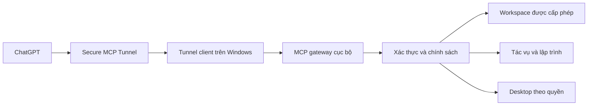
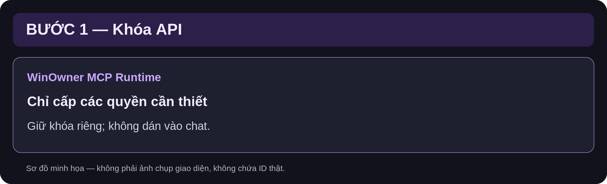
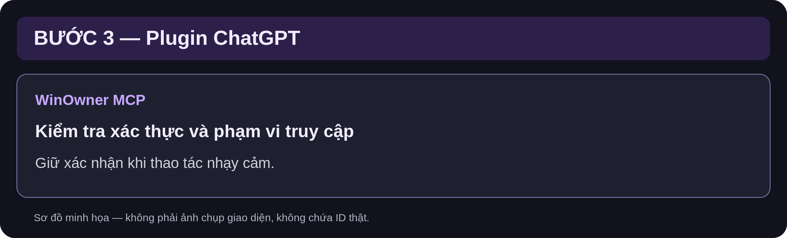
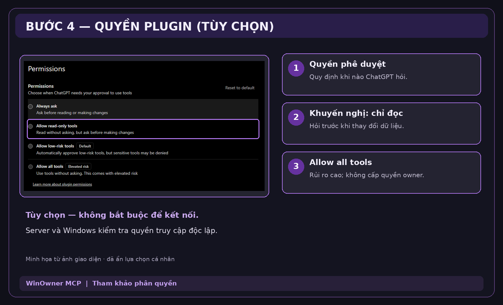

<div align="center">

# WinOwner MCP v1.2.0

**Không gian làm việc Windows của bạn, ngay trong ChatGPT.**

MCP gateway mã nguồn mở cho Windows, hỗ trợ kiểm tra workspace, quy trình lập trình có kiểm soát và quản lý tác vụ theo đúng quyền được cấp.

Windows 10/11 · Model Context Protocol · MIT

[English](README.md) | **Tiếng Việt**

[Tổng quan](#tổng-quan) · [Tính năng](#tính-năng-chính) · [Kiến trúc](#kiến-trúc) · [Bắt đầu nhanh](#bắt-đầu-nhanh) · [34 công cụ](docs/CAPABILITIES.md) · [Bảo mật & Phân quyền](#bảo-mật--phân-quyền) · [Xử lý sự cố](#xử-lý-sự-cố)

</div>

## Tổng quan

WinOwner MCP kết nối máy Windows của chính bạn với ChatGPT thông qua tunnel riêng có xác thực, thay vì đẩy dữ liệu lên máy ảo đám mây. MCP gateway cục bộ chỉ lắng nghe trên loopback (`127.0.0.1:8768`), kiểm tra xác thực và chính sách trên từng yêu cầu, mặc định chế độ `read_only`, đồng thời giữ nguyên ranh giới phân quyền NTFS và phiên Windows.

## Tính năng chính

| Tính năng | Lợi ích mang lại |
|---|---|
| Hành trình 4 bước chuẩn Windows | Một lệnh cài (`go.ps1`) hoặc giải nén ZIP (`Install-WinOwner.cmd`) kèm **WinOwner Setup Center** (`/setup`) theo dõi thực tế `LOCAL_READY -> CHATGPT_CONNECTED -> OWNER_VERIFIED -> OWNER_CONTROL_READY` |
| Kiểm tra workspace & Git | Đọc thư mục được cấp phép (hỗ trợ cả Git worktree hợp lệ), xem tệp văn bản, kiểm tra `git status` và `git diff` |
| Quy trình lập trình có phạm vi | Chỉnh sửa tệp, chạy kiểm thử và lệnh chỉ trong phạm vi đã được phê duyệt rõ ràng |
| Ghép nối chủ máy có xác minh | Xác nhận một lần qua mã thử thách (`XXXX-XXXX`) ngay trên máy Windows — không cần tự tìm/nhập `client_id` và không dán owner token vào ChatGPT |
| Quản lý tác vụ & ranh giới Desktop | Điều phối tác vụ nền, quan sát màn hình, chụp ảnh, thao tác chuột/phím bị giới hạn nghiêm ngặt theo danh tính owner đã xác minh, chính sách và phiên Windows |
| Tiện ích vòng đời & khôi phục | Giao diện WinOwner Setup Center, tự chẩn đoán (`Check-WinOwner.cmd`), cấu hình lại tunnel an toàn (`Connect-ChatGPT.cmd`), cập nhật bản phát hành có xác minh SHA-256 và gỡ cài đặt sạch |

## Kiến trúc



- Gateway cục bộ chỉ bind `127.0.0.1`, không thiết kế để mở trực tiếp ra mạng công cộng.
- Kết nối sử dụng HTTPS đi ra thông qua `tunnel-client` chính thức của OpenAI (được tải và kiểm tra SHA-256 trong `Connect-ChatGPT.cmd`).
- WinOwner chạy dưới phiên người dùng Windows hiện tại, không tự động nâng quyền Administrator và không vượt qua NTFS/UAC.

## Yêu cầu hệ thống

- Windows 10 hoặc Windows 11 (x64) và Windows PowerShell 5.1.
- Python 3.12 (bộ cài có thể cài tự động qua `winget` nếu hỗ trợ, hoặc cài thủ công từ python.org).
- Kết nối Internet đi ra, tài khoản/workspace ChatGPT đủ quyền thêm custom MCP server và quyền OpenAI Platform để tạo Runtime API key và Tunnel.
- Phiên người dùng Windows đang hoạt động; các công cụ tương tác Desktop đòi hỏi phiên màn hình đang mở khóa.

## Bắt đầu nhanh

### Cài đặt cục bộ

> Phiên bản `v1.2.0` chưa được phát hành chính thức. Chỉ chạy lệnh dưới đây sau khi xác nhận tag `v1.2.0` đã xuất hiện trên [GitHub Releases](https://github.com/phuonghuster7/winowner-mcp/releases).

Mở Command Prompt (**CMD**) trên Windows khi `v1.2.0` đã phát hành (hoặc giải nén gói ZIP phát hành và nhấp đúp `Install-WinOwner.cmd`):

```cmd
powershell -NoP -C "irm https://github.com/phuonghuster7/winowner-mcp/raw/v1.2.0/go.ps1|iex"
```

Mặc định, WinOwner cài đặt vào `%LOCALAPPDATA%\WinOwnerMCP\v1.2.0` ở chế độ `read_only`, tạo môi trường `.venv` riêng, đăng ký tác vụ Task Scheduler theo người dùng hiện tại, rồi tự kiểm tra `/health` và chặn truy cập ẩn danh HTTP `401` (`LOCAL_INSTALL_PASS` -> trạng thái `LOCAL_READY`). Nhấp đúp `Open-SetupCenter.cmd` (hoặc chạy `Check-WinOwner.cmd -OpenSetupCenter`) để mở **WinOwner Setup Center** song ngữ Việt/Anh (`http://127.0.0.1:8767/setup`) đăng nhập tự động theo tài khoản Windows hiện tại qua mã handoff dùng một lần — không cần nhập Admin Key thủ công và không cần dùng dòng lệnh:

1. **Cài đặt (`LOCAL_READY`):** Dịch vụ cục bộ chạy ổn định trên `127.0.0.1:8768` và chặn mọi truy cập ẩn danh bằng HTTP `401`.
2. **Kết nối (`CHATGPT_CONNECTED`):** Tunnel riêng đã kết nối (chọn **OAuth 2.1** để ghép nối chủ máy hoặc **Authentication: None** cho chỉ đọc) và ChatGPT gọi thành công một công cụ đọc thật (không bao giờ báo xanh giả chỉ từ `/health` hay `/readyz`).
3. **Xác nhận một lần (`OWNER_VERIFIED`):** Khi client ChatGPT OAuth 2.1 yêu cầu quyền chủ máy, kiểm tra tên client, `client_id` đã che, mã `XXXX-XXXX`, phạm vi và thời hạn ngay trong WinOwner Setup Center rồi bấm một nút **"Xác nhận cấp quyền chủ máy"** (hoặc dùng `Grant-OwnerAccess.cmd`) — không nhập `client_id` thủ công, không dán owner token vào khung chat.
4. **Sử dụng lâu dài (`OWNER_CONTROL_READY`):** Quyền hạn thực tế (`Read`, `Scoped`, hoặc `Owner`) và hồ sơ quyền đã ký HMAC tự động khôi phục qua các lần khởi động lại cho đúng client đã duyệt cho đến khi hết hạn, bấm **Thu hồi quyền (Revoke Access)** hoặc bật **Dừng khẩn cấp (Emergency Stop)**.

### Kết nối ChatGPT

Sử dụng đúng OpenAI organization và ChatGPT workspace được cấp phép. Bốn hình hướng dẫn giao diện dưới đây dùng định danh minh họa (`tunnel_1234...`), không chứa thông tin đăng nhập thật.

#### Bước 1 · Tạo Runtime API key

[Trang OpenAI API keys](https://platform.openai.com/settings/organization/api-keys) · [Hướng dẫn Secure MCP Tunnels chính thức](https://developers.openai.com/api/docs/guides/secure-mcp-tunnels)



1. **Đặt tên key:** nhập tên dễ nhận biết như `WinOwner MCP Runtime`.
2. **Quyền API:** ảnh đang chọn `All` **để minh họa giao diện, không phải quyền bắt buộc**. Khi tạo khóa runtime thực tế, nên chọn `Restricted` với quyền **Tunnels Read + Use** nếu tài khoản hỗ trợ; quyền tạo hoặc sửa tunnel (**Tunnels Read + Manage**) dành riêng cho người quản trị được phép. `All` cấp quyền API rộng hơn nhu cầu của tunnel client. Xem [phân quyền chính thức của OpenAI](https://developers.openai.com/api/docs/guides/secure-mcp-tunnels).
3. **Tạo key:** bấm **Create secret key** và giữ khóa riêng tư (chỉ dùng cho `tunnel-client` trên máy; tuyệt đối không dán khóa vào khung chat, Git hoặc ảnh chụp màn hình).

#### Bước 2 · Tạo Tunnel riêng

[Trang OpenAI Tunnels](https://platform.openai.com/settings/organization/tunnels) · [Tài liệu tunnel-client chính thức](https://github.com/openai/tunnel-client/blob/master/docs/end-user-guide.md)


1. **Đặt tên tunnel:** nhập tên như `winowner-mcp` và mô tả ngắn như `WinOwner MCP`.
2. **Chọn tổ chức và workspace:** dùng OpenAI organization được cấp phép và ChatGPT workspace tương ứng (với tài khoản cá nhân/một tổ chức, chọn tổ chức và workspace mặc định).
3. **Tạo tunnel:** bấm **Create**, sau đó sao chép `Tunnel ID` (`tunnel_...`).

Tiếp theo, chạy `Connect-ChatGPT.cmd` trong `%LOCALAPPDATA%\WinOwnerMCP\v1.2.0` và nhập Runtime API key (ô nhập ẩn) cùng `Tunnel ID`. Runtime API key dùng để xác thực `tunnel-client`, còn `Tunnel ID` định danh đường kết nối.

#### Bước 3 · Tạo Plugin trong ChatGPT

[Trang plugin ChatGPT](https://chatgpt.com/plugins) · [Hướng dẫn Secure MCP Tunnels chính thức](https://developers.openai.com/api/docs/guides/secure-mcp-tunnels) · [Giải thích Authentication None](docs/AUTH_NONE.vi.md)



1. **Mở hộp thoại thêm MCP:** vào mục Plugins trên ChatGPT, bấm **Add > Add custom MCP server**.
2. **Nhập tên plugin:** điền `winowner-mcp` và mô tả ngắn nếu cần (ví dụ `remote desktop`).
3. **Chọn Tunnel và dán ID:** chuyển **Connection** sang **Tunnel** rồi dán `Tunnel ID` đã tạo ở Bước 2.
4. **Chọn Authentication và tạo plugin:** chỉ chọn `No authentication` cho nhu cầu **chỉ đọc (`Read`)** khi WinOwner đã bảo vệ tầng tunnel riêng và backend cục bộ. **Giới hạn nền tảng:** `Authentication: None` qua tunnel dùng chung không gửi danh tính từng client có thể xác minh xuống máy Windows, nên luôn bị giới hạn nghiêm ngặt ở mức `read_only` (`Read`) và không thể nâng lên quyền chủ máy. Để sử dụng quyền `Scoped` hoặc `Owner`, hãy kết nối qua OAuth 2.1 và phê duyệt yêu cầu ghép nối một lần trên máy. Đọc cảnh báo rủi ro, đánh dấu xác nhận và bấm **Create as a plugin**. Giữ quyền ban đầu ở mức `read_only`.

#### Bước 4 · Quyền Plugin (tùy chọn)

[Tài liệu quản lý quyền ứng dụng trong ChatGPT](https://help.openai.com/en/articles/20001495-managing-app-permissions-in-chatgpt)



Bước này là **tùy chọn và không bắt buộc để kết nối**.

1. **Mở phần cài đặt plugin:** vào `Plugin settings > winowner-mcp`.
2. **Mở Permissions:** chọn chế độ khi nào ChatGPT cần hỏi xác nhận trước khi gọi tool (`Always ask`, `Allow read-only tools`, `Allow low-risk tools`, hoặc `Allow all tools`).
3. **Ưu tiên giữ xác nhận cho thao tác nhạy cảm:** nên chọn `Allow read-only tools` hoặc `Allow low-risk tools`. Dù ảnh minh họa chỉ cách chọn `Allow all tools` nếu muốn ít bị hỏi hơn, lựa chọn đó mang **rủi ro cao (`Elevated risk`)** và **không cấp quyền owner phía backend**.

**Phê duyệt của ChatGPT và quyền của backend là hai lớp độc lập:** thiết lập trên ChatGPT chỉ kiểm soát việc hỏi xác nhận ở giao diện chat. Backend WinOwner và Windows tự kiểm tra độc lập danh tính, OAuth owner delegation, capability grant và chính sách workspace trên từng request. Chọn `Allow all tools` không thể vượt qua kiểm tra phía backend.

### Kiểm tra kết nối

| Kết quả / Trạng thái | Phạm vi đã xác minh |
|---|---|
| `LOCAL_INSTALL_PASS` / `LOCAL_READY` | Dịch vụ MCP cục bộ chạy ổn định và chặn ẩn danh HTTP `401` (`Local Service: Ready`) |
| `TUNNEL_SETUP_PASS` / `TUNNEL_READY` | Tác vụ `tunnel-client` cục bộ đang chạy và `/readyz` phản hồi sẵn sàng (`Tunnel: Connected`, ChatGPT vẫn `Not Verified`) |
| `CHATGPT_CONNECTED` | ChatGPT gọi thành công công cụ chỉ đọc thật qua MCP (`ChatGPT: Verified`) |
| `OWNER_VERIFIED` / `OWNER_CONTROL_READY` | Đã phê duyệt yêu cầu ghép nối chủ máy OAuth 2.1 có xác minh trên máy (`Owner Identity: Verified`, `Permissions: Scoped` hoặc `Owner`) |

Các mức kiểm tra này độc lập với nhau. Luôn kiểm thử bằng tác vụ chỉ đọc an toàn trên workspace kiểm thử trước khi phê duyệt quyền ghi hoặc quyền owner trong **WinOwner Setup Center**.

## Ví dụ sử dụng

Sau khi kết nối, hãy thử trước các câu lệnh chỉ đọc trong một workspace kiểm thử đã được phê duyệt:

- `"Liệt kê các workspace đã được phê duyệt."`
- `"Tóm tắt trạng thái Git của dự án được cấp phép mà không sửa bất kỳ tệp nào."`
- `"Hiển thị trạng thái tác vụ hiện có."`

Cấu trúc phản hồi chỉ đọc minh họa:

```text
Approved workspaces:
- D:\SampleWorkspace (read_only)

Git status summary:
- branch: feat/example
- modified files: 0
- untracked files: 0

Task status:
- no active mutating tasks
```

*Chỉ là ví dụ dữ liệu giả để minh họa cấu trúc phản hồi, không phải ảnh/video hay kết quả nghiệm thu thực tế.*

## Danh mục chức năng — 34 công cụ

Danh mục cloud bao gồm **14 tool cơ bản** và **20 tool thuộc danh mục owner** (**tổng 34 mục trong danh mục**). WinOwner mặc định `read_only`; một tool xuất hiện trong danh mục không đồng nghĩa đã được cấp quyền thực thi.

| Nhóm chức năng | Cơ bản | Danh mục owner | Giới hạn truy cập & an toàn |
|---|---:|---:|---|
| Đọc workspace & Git | 4 | 0 | Đọc thư mục được duyệt và thông tin Git |
| Thay đổi tệp & thư mục | 2 | 6 | Quyền ghi theo phạm vi (`read_only` chặn ghi nếu chưa có grant hợp lệ) |
| Lập trình & chạy kiểm thử | 2 | 0 | Cần cấp quyền thực thi riêng; không phải sandbox hệ điều hành |
| Gửi & theo dõi tác vụ | 6 | 0 | Gửi tác vụ không đồng nghĩa tự động thực thi |
| Điều phối vòng đời tác vụ | 0 | 4 | Tạm dừng, tiếp tục, hủy và dừng khẩn cấp cần xác thực owner |
| Quan sát & tương tác Desktop | 0 | 9 | Chỉ owner xác thực; chịu giới hạn phiên Windows và chính sách |
| Thực thi hệ thống | 0 | 1 | `agent_powershell_execute`; kiểm tra quyền owner nghiêm ngặt & ACL Windows |
| **Tổng cộng** | **14** | **20** | **34 mục danh mục — không phải 34 quyền bật sẵn** |

Xem chi tiết 34 định danh tool và mô hình phân tầng quyền tại [docs/CAPABILITIES.md](docs/CAPABILITIES.md).

## Bảo mật & Phân quyền

WinOwner tách biệt cơ chế bảo vệ thành 3 lớp kiểm tra độc lập:

1. **Quyền phê duyệt trên ChatGPT (lớp giao diện):** kiểm soát khi nào ChatGPT hỏi trước lúc gọi tool (`Always ask`, `Allow read-only tools`, `Allow all tools`). Đây là tùy chọn giao diện, không có hiệu lực cấp quyền trên máy Windows.
2. **Xác thực và chính sách backend WinOwner (lớp gateway):** bắt buộc có thông tin xác thực caller/tunnel hợp lệ, mặc định `read_only`, tách biệt xác thực chủ máy OAuth (`Grant-OwnerAccess.cmd`) khỏi khóa tunnel dùng chung, đồng thời kiểm tra phạm vi đường dẫn và capability grant ở mọi lượt gọi tool.
3. **Kiểm soát của hệ điều hành Windows (lớp OS):** tiến trình chạy dưới tài khoản người dùng chuẩn; quyền NTFS và UAC của Windows luôn có hiệu lực.

Các tiện ích quản trị cục bộ trong `%LOCALAPPDATA%\WinOwnerMCP\v1.2.0`:

- **WinOwner Setup Center (`Open-SetupCenter.cmd` -> `http://127.0.0.1:8767/setup`):** trung tâm thiết lập song ngữ Việt/Anh tự động đăng nhập theo người dùng Windows hiện tại (không cần nhập Admin Key thủ công), hiển thị bảng trạng thái 6 hàng trực tiếp (`Local Service`, `Tunnel`, `ChatGPT`, `Owner Identity`, `Permissions`, `Version`), nút **Dừng khẩn cấp (E-Stop)**, xác nhận 1 nút **Xác nhận cấp quyền chủ máy** và 8 thao tác (`Cài đặt / Sửa chữa`, `Kết nối ChatGPT`, `Xác minh kết nối`, `Duyệt quyền Chủ máy`, `Thu hồi quyền`, `Cấu hình lại Tunnel`, `Kiểm tra cập nhật`, `Gỡ cài đặt`). Cũng có thể mở qua `Check-WinOwner.cmd -OpenSetupCenter`.
- `Check-WinOwner.cmd`: kiểm tra dịch vụ cục bộ, chặn ẩn danh HTTP `401`, trạng thái sẵn sàng của tunnel và bảng trạng thái 4 bước (`-Json`).
- `Connect-ChatGPT.cmd` & `Disconnect-ChatGPT.cmd`: kết nối, cấu hình lại tunnel an toàn (`-Reconfigure` có sao lưu, kiểm tra trước khi chuyển và tự động rollback nếu lỗi) hoặc ngắt tác vụ tunnel cục bộ đã xác minh.
- `Uninstall-WinOwner.cmd`: dừng và gỡ sạch dịch vụ MCP cùng tác vụ tunnel đã xác minh, giữ an toàn dữ liệu và khóa riêng.
- [Quản trị nâng cao](docs/ADVANCED_CHATGPT.vi.md): `Grant-OwnerAccess.cmd` (duyệt yêu cầu ghép nối chủ máy có xác minh mà không cần nhập `client_id` thủ công), `Show-OwnerKey.cmd` (hiển thị tóm tắt trạng thái ghép nối không lộ khóa) và `Revoke-OwnerAccess.cmd` (thu hồi sạch delegation, grant và token).

Xem thêm [SECURITY.md](SECURITY.md), [docs/INSTALLATION.md](docs/INSTALLATION.md) và [docs/START_HERE.vi.md](docs/START_HERE.vi.md).

## Xử lý sự cố

| Triệu chứng | Hướng kiểm tra |
|---|---|
| Cài đặt cục bộ báo lỗi | Xem `WinOwner-SETUP-RESULT.txt`, chạy lại `Check-WinOwner.cmd`, kiểm tra Python 3.12 và cổng `8768` |
| Báo lỗi HTTP `401` | Đảm bảo đã chạy `Connect-ChatGPT.cmd` với Runtime API key và Tunnel ID hợp lệ; không tắt xác thực backend |
| Tunnel chưa sẵn sàng / `429` | Kiểm tra tiến trình `tunnel-client`, mạng đi ra và giới hạn tần suất qua `Check-WinOwner.cmd` |
| Tool bị từ chối quyền | Kiểm tra phạm vi workspace, chế độ `read_only` hoặc capability grant; không tự hạ chuẩn xác thực |
| Cần ngắt kết nối khẩn cấp | Chạy `Disconnect-ChatGPT.cmd` hoặc kích hoạt dừng khẩn cấp và thu hồi grant riêng |

Chi tiết các bước khắc phục xem tại [docs/TROUBLESHOOTING.md](docs/TROUBLESHOOTING.md).

## Giấy phép

Phát hành theo giấy phép [MIT](LICENSE).

- [Bản phát hành](https://github.com/phuonghuster7/winowner-mcp/releases) · [Lịch sử CI](https://github.com/phuonghuster7/winowner-mcp/actions) · [Hướng dẫn đóng góp](CONTRIBUTING.md)
- CI tự động kiểm tra mã nguồn sạch, quét bảo mật tĩnh, đóng gói ZIP và chạy thử cục bộ; CI không thay thế cho việc nghiệm thu ghép nối ChatGPT thực tế, độ tương thích trên mọi máy hay chứng nhận an toàn.
- Dự án mã nguồn mở độc lập, không trực thuộc OpenAI hay Microsoft.
