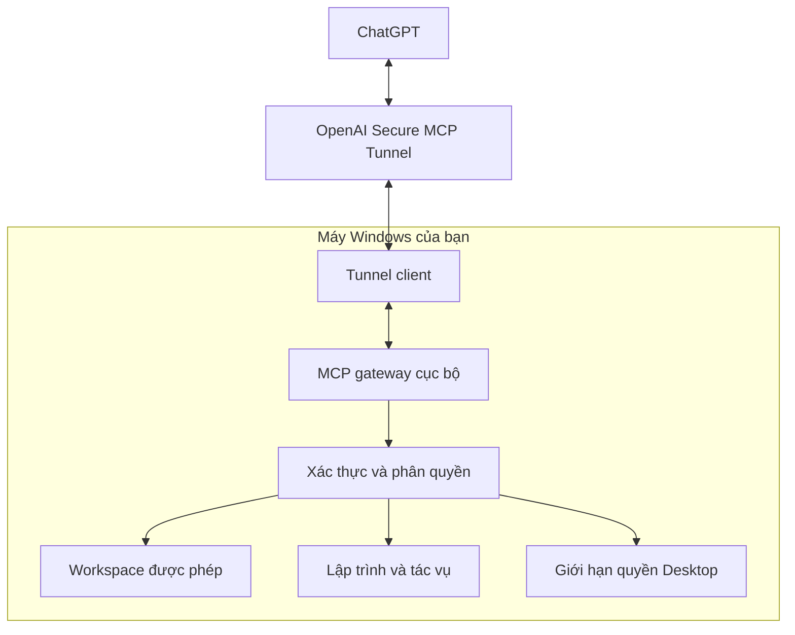
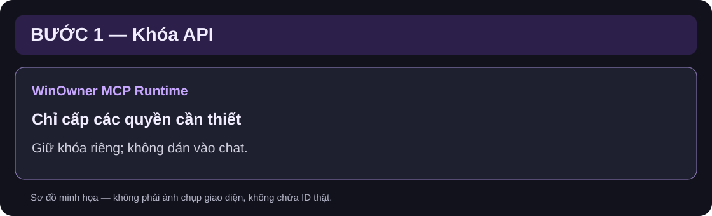
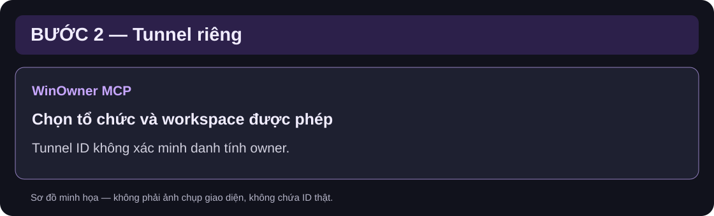
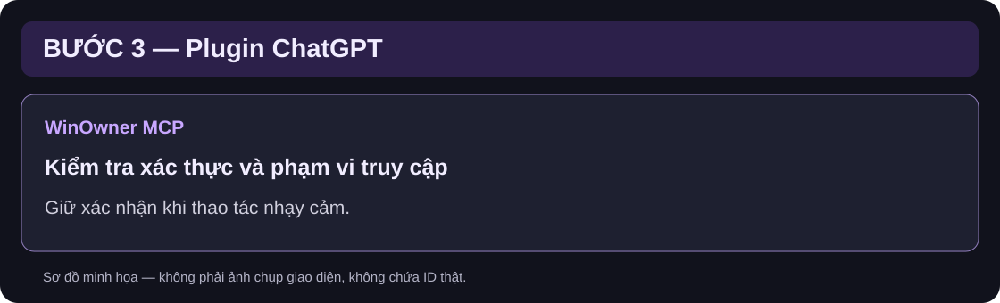
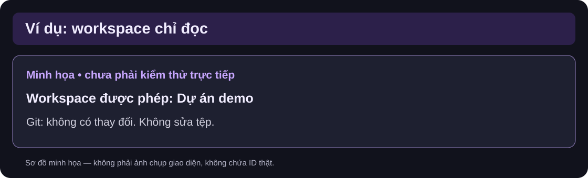

<div align="center">

# WinOwner MCP v1.2.0

**Không gian làm việc Windows của bạn, ngay trong ChatGPT.**

MCP gateway mã nguồn mở cho Windows, hỗ trợ đọc workspace, phát triển phần mềm và quản lý tác vụ theo quyền được cấp.

Windows 10/11 · Model Context Protocol · MIT

[English](README.md) | **Tiếng Việt**

[Bắt đầu](#cài-đặt-và-kết-nối) · [Tính năng](#tính-năng) · [Kiến trúc](#kiến-trúc) · [Danh sách tool](docs/CAPABILITIES.md) · [Xử lý lỗi](docs/TROUBLESHOOTING.md)

</div>

## Vì sao dùng WinOwner?

WinOwner hoạt động trên chính máy Windows của bạn, thay vì thay thế workspace bằng máy ảo cloud. Kết nối riêng, xác thực và phân quyền tại server. Mặc định chỉ đọc; thao tác nhạy cảm cần quyền riêng.

## Tính năng

| Tính năng | Lợi ích |
|---|---|
| Cài đặt cho Windows | Một lệnh cài local, tự kiểm tra dịch vụ và xác thực |
| Workspace và Git | Đọc thư mục, tệp văn bản, trạng thái và thay đổi Git trong phạm vi được phép |
| Lập trình | Chỉnh sửa và kiểm thử trong phạm vi được cấp quyền |
| Quản lý tác vụ | Xem trạng thái, nhật ký, diff và kết quả; điều phối cần quyền riêng |
| Tích hợp Desktop | Các chức năng trong danh mục owner, tùy danh tính, chính sách và phiên Windows |
| Quản lý kết nối | Kiểm tra local, ngắt tunnel và gỡ cài đặt |

## Kiến trúc



Gateway cục bộ không được thiết kế để công khai ra Internet. Tunnel cần HTTPS đi ra ngoài; máy Windows và dịch vụ liên quan phải hoạt động. Gateway không tự nâng quyền Windows.

## Yêu cầu

- Windows 10/11 x64 và Windows PowerShell 5.1.
- Python 3.12; bộ cài có thể cài qua winget nếu khả dụng.
- Internet, tài khoản/workspace ChatGPT có quyền thêm custom MCP server và quyền tunnel tương ứng trên Platform.
- Phiên người dùng Windows; các chức năng tương tác Desktop có điều kiện phiên riêng.

## Cài đặt và kết nối

### Cài đặt cục bộ
Mở Command Prompt (CMD) trên Windows khi bản phát hành tương ứng đã sẵn sàng.
```cmd
powershell -NoP -C "irm https://github.com/phuonghuster7/winowner-mcp/raw/v1.2.0/go.ps1|iex"
```
Bộ cài tự kiểm tra dịch vụ và xác thực trên máy.

> Bản v1.2.0 chưa được phát hành. [Các bản phát hành](https://github.com/phuonghuster7/winowner-mcp/releases).

### Kết nối ChatGPT

Chỉ sử dụng tổ chức và workspace được cấp phép. Các hình dưới đây là sơ đồ minh họa, không phải ảnh chụp giao diện OpenAI.

#### 1 · Runtime API key

[Trang API keys](https://platform.openai.com/settings/organization/api-keys) · [Yêu cầu tunnel chính thức](https://developers.openai.com/api/docs/guides/secure-mcp-tunnels)



#### 2 · Tunnel riêng

[Trang Tunnels](https://platform.openai.com/settings/organization/tunnels) · [Giao diện tham khảo chính thức](https://github.com/openai/tunnel-client/blob/master/docs/end-user-guide.md)



Tiện ích kết nối cục bộ là `Connect-ChatGPT.cmd`. Runtime API key xác thực tunnel client; Tunnel ID định danh đường kết nối. Không chia sẻ khóa trong chat hoặc ảnh chụp.

#### 3 · Plugin ChatGPT

[Trang plugin ChatGPT](https://chatgpt.com/plugins) · [Hướng dẫn kết nối chính thức](https://developers.openai.com/api/docs/guides/secure-mcp-tunnels)



Thiết lập Authentication phải phù hợp với cấu hình server đã xác minh. Giữ quyền chỉ đọc ban đầu; quyền sử dụng tunnel không xác minh danh tính owner.

#### 4 · Quyền plugin (tùy chọn)

Xem các lựa chọn phê duyệt. `Allow all tools` giảm yêu cầu xác nhận, tăng rủi ro và không cấp quyền owner. Nên giữ xác nhận riêng với thao tác nhạy cảm. [Tài liệu phân quyền](https://help.openai.com/en/articles/20001495-managing-app-permissions-in-chatgpt).

### Kiểm tra kết nối

| Kết quả | Phạm vi đã kiểm tra |
|---|---|
| `LOCAL_INSTALL_PASS` / `CHECK_PASS` | Dịch vụ và xác thực cục bộ |
| `TUNNEL_SETUP_PASS` / `TUNNEL_READY` | Tunnel sẵn sàng tại máy |
| Tác vụ chỉ đọc thành công | Kết nối ChatGPT đối với tác vụ đó |

Ba kiểm tra này độc lập. Xác minh bằng tác vụ đọc không nhạy cảm trên workspace kiểm thử được cấp phép.

## Ví dụ sử dụng

Sau khi kết nối, thử với workspace kiểm thử đã được phép:

- "Liệt kê các workspace đã được phê duyệt."
- "Tóm tắt trạng thái Git dự án, không sửa bất kỳ tệp nào."
- "Cho biết trạng thái tác vụ hiện có."



*Chỉ là ví dụ minh họa bằng dữ liệu giả, không phải video hay kết quả nghiệm thu trực tiếp.*

## Chức năng & quyền truy cập

Danh mục cloud gồm **14 tool cơ bản, tối đa 34 tool khi đủ điều kiện owner**. Mặc định chỉ đọc; việc xuất hiện tool không đồng nghĩa được phép thực thi.

| Nhóm chức năng | Danh mục cơ bản | Bổ sung cho owner | Giới hạn quyền |
|---|---:|---:|---|
| Đọc workspace và Git | 4 | 0 | Đọc trong phạm vi cho phép |
| Thay đổi tệp và thư mục | 2 | 6 | Quyền ghi có phạm vi; kiểm tra owner với tool bổ sung |
| Lập trình và kiểm thử | 2 | 0 | Cần cấp quyền thực thi riêng |
| Gửi và theo dõi tác vụ | 6 | 0 | Gửi tác vụ không đồng nghĩa được thực thi |
| Điều phối tác vụ | 0 | 4 | Xác thực và cấp quyền owner |
| Quan sát, tương tác Desktop | 0 | 9 | Xác thực owner, điều kiện phiên và chính sách |
| Thực thi hệ thống | 0 | 1 | Cấp quyền riêng và giới hạn của Windows |
| **Tổng** | **14** | **20** | **34 tool trong danh mục, không phải 34 quyền được cấp sẵn** |

[Xem danh sách 34 tool và mô hình quyền](docs/CAPABILITIES.md).

## Bảo mật và phân quyền

Mặc định chỉ đọc; thấy tool không có nghĩa được phép thực thi. Khóa tunnel không xác minh danh tính owner. Quyền Windows vẫn được áp dụng; thực thi đặc quyền không phải sandbox hệ điều hành. Xem [bảo mật](SECURITY.md) và [mô hình quyền](docs/CAPABILITIES.md).

## Quản lý
- `Disconnect-ChatGPT.cmd`: ngắt tunnel đã xác minh.
- `Uninstall-WinOwner.cmd`: dừng và gỡ dịch vụ.
- [Quản trị nâng cao](docs/ADVANCED_CHATGPT.vi.md): Show-OwnerKey và các tiện ích quản trị không thuộc luồng cài đặt ban đầu. Ghép nối owner và thu hồi quyền cần nghiệm thu riêng.

Chỉ khi cần xử lý lỗi, dùng `Check-WinOwner.cmd` trong `%LOCALAPPDATA%\WinOwnerMCP\v1.2.0`.

[Hướng dẫn người mới](docs/START_HERE.vi.md) · [Cài đặt và sửa lỗi](docs/INSTALLATION.md) · [Bảo mật](SECURITY.md)

## Xử lý sự cố

| Tình trạng | Kiểm tra |
|---|---|
| Cài đặt local lỗi | Đọc kết quả cài đặt và thông tin chẩn đoán local |
| Tunnel không khả dụng | Kiểm tra kết nối và điều kiện tài khoản/workspace |
| Tool từ chối | Kiểm tra phạm vi đã cấp; không bỏ xác thực |
| Cần ngắt kết nối | Dùng tiện ích ngắt local và kiểm tra quyền từ xa riêng |

Xem thêm [hướng dẫn xử lý lỗi](docs/TROUBLESHOOTING.md).

## Thông tin dự án

[Bản phát hành](https://github.com/phuonghuster7/winowner-mcp/releases) · [Lịch sử CI](https://github.com/phuonghuster7/winowner-mcp/actions) · [Đóng góp](CONTRIBUTING.md) · [Giấy phép](LICENSE)

CI không thay thế nghiệm thu ghép nối ChatGPT thực tế hay chứng nhận an toàn trên mọi máy.

MIT · Dự án độc lập với OpenAI và Microsoft.
