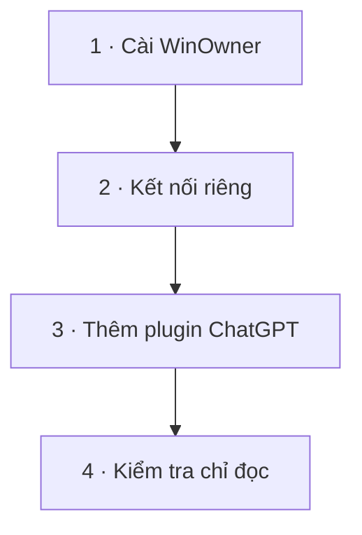

# WinOwner MCP v1.2.0

Kết nối máy Windows 10/11 của bạn với ChatGPT để thực hiện tác vụ đọc đã được cho phép.

[English](README.md) | **Tiếng Việt**

[Hướng dẫn kỹ thuật](docs/ADVANCED_CHATGPT.vi.md)



## 1. Cài đặt
Mở Command Prompt (CMD) trên Windows. Lệnh cài đặt dành cho bản v1.2.0 đã phát hành:
```cmd
powershell -NoP -C "irm https://github.com/phuonghuster7/winowner-mcp/raw/v1.2.0/go.ps1|iex"
```
Bộ cài tự kiểm tra dịch vụ và xác thực trên máy. Khi cài đặt thành công, không cần chạy thêm bước kiểm tra thủ công.

> Lệnh này chỉ hoạt động sau khi tag v1.2.0 được phát hành. [Các bản phát hành](https://github.com/phuonghuster7/winowner-mcp/releases).

## 2. Kết nối riêng
Xem [hướng dẫn Secure MCP Tunnel chính thức](https://developers.openai.com/api/docs/guides/secure-mcp-tunnels). Cần phân biệt **Tunnel ID** (mã đường kết nối) và **runtime API key** (khóa xác thực). Tiện ích cấu hình hiện có: `Connect-ChatGPT.cmd`. Không gửi khóa qua chat.

## 3. Tạo plugin ChatGPT
Xem [hướng dẫn tạo plugin của OpenAI](https://developers.openai.com/api/docs/guides/custom-mcp-server). Kiểm tra quyền được yêu cầu, giữ chế độ chỉ đọc ban đầu. Authentication không thay thế xác minh chủ máy.

## 4. Kiểm tra kết nối
Máy hoạt động ≠ tunnel sẵn sàng ≠ ChatGPT kết nối thành công. Kiểm tra bằng một tác vụ đọc không nhạy cảm.

## Chức năng & quyền truy cập

Danh mục cloud gồm **14 tool cơ bản, tối đa 34 tool khi đủ điều kiện owner**. Mặc định chỉ đọc; việc xuất hiện tool không đồng nghĩa được phép thực thi.

| Nhóm | Phạm vi |
|---|---|
| Tệp, workspace, Git | Đọc dữ liệu được phép; ghi cần quyền riêng |
| Lập trình và kiểm thử | Thực thi cần cấp quyền riêng |
| Tác vụ | Theo dõi, điều phối theo quyền |
| Desktop và hệ thống | Quyền nhạy cảm, cần xác thực và cấp phép |

[Xem danh sách 34 tool và mô hình quyền](docs/CAPABILITIES.md).

## Quản lý
- `Disconnect-ChatGPT.cmd`: ngắt tunnel đã xác minh.
- `Uninstall-WinOwner.cmd`: dừng và gỡ dịch vụ.
- [Quản trị nâng cao](docs/ADVANCED_CHATGPT.vi.md): Show-OwnerKey và các tiện ích quản trị không thuộc luồng cài đặt ban đầu. Ghép nối owner và thu hồi quyền cần nghiệm thu riêng.

Chỉ khi cần xử lý lỗi, dùng `Check-WinOwner.cmd` trong `%LOCALAPPDATA%\WinOwnerMCP\v1.2.0`.

[Hướng dẫn người mới](docs/START_HERE.vi.md) · [Cài đặt và sửa lỗi](docs/INSTALLATION.md) · [Bảo mật](SECURITY.md)

MIT · Dự án độc lập với OpenAI và Microsoft.
