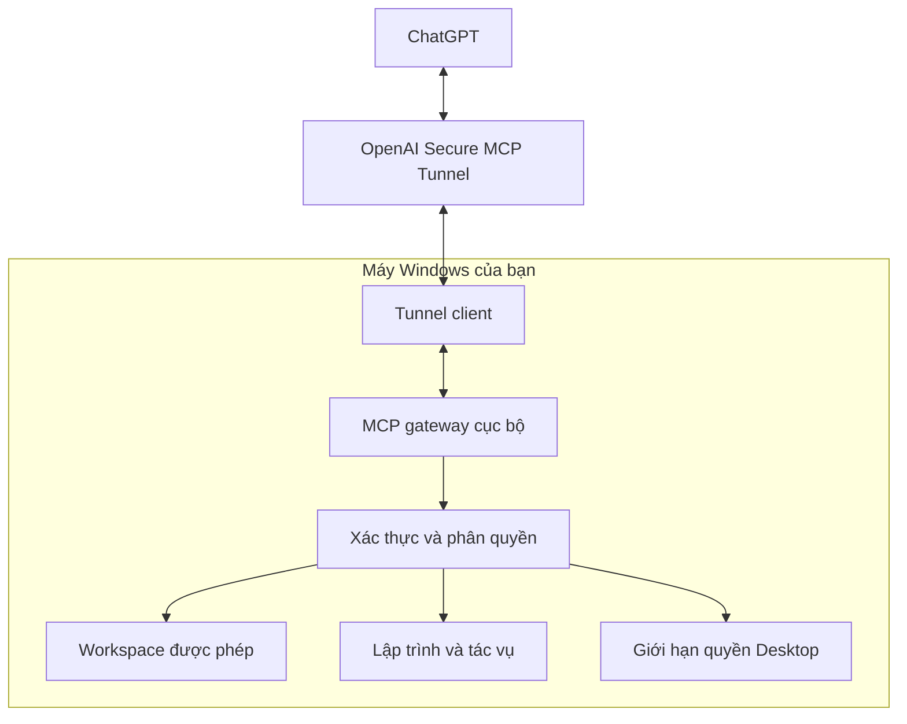

<div align="center">

# WinOwner MCP v1.2.0

**Không gian làm việc Windows của bạn, ngay trong ChatGPT.**

MCP gateway mã nguồn mở cho Windows, hỗ trợ đọc workspace, phát triển phần mềm và quản lý tác vụ theo quyền được cấp.

Windows 10/11 · Model Context Protocol · MIT

[English](README.md) | **Tiếng Việt**

[Bắt đầu](#cài-đặt-và-kết-nối) · [Tính năng](#tính-năng) · [Kiến trúc](#kiến-trúc) · [Danh sách tool](docs/CAPABILITIES.md) · [Xử lý lỗi](docs/TROUBLESHOOTING.md)

</div>

## Vì sao dùng WinOwner?

WinOwner hoạt động trên chính máy Windows của bạn, thay vì thay thế workspace bằng máy ảo cloud. Kết nối riêng, xác thực và phân quyền tại server. Mặc định chỉ đọc; thao tác nhạy cảm cần quyền riêng.

## Tính năng

| Tính năng | Lợi ích |
|---|---|
| Cài đặt cho Windows | Một lệnh cài local, tự kiểm tra dịch vụ và xác thực |
| Workspace và Git | Đọc thư mục, tệp văn bản, trạng thái và thay đổi Git trong phạm vi được phép |
| Lập trình | Chỉnh sửa và kiểm thử trong phạm vi được cấp quyền |
| Quản lý tác vụ | Xem trạng thái, nhật ký, diff và kết quả; điều phối cần quyền riêng |
| Tích hợp Desktop | Các chức năng trong danh mục owner, tùy danh tính, chính sách và phiên Windows |
| Quản lý kết nối | Kiểm tra local, ngắt tunnel và gỡ cài đặt |

## Kiến trúc



Gateway cục bộ không được thiết kế để công khai ra Internet. Tunnel cần HTTPS đi ra ngoài; máy Windows và dịch vụ liên quan phải hoạt động. Gateway không tự nâng quyền Windows.

## Yêu cầu

- Windows 10/11 x64 và Windows PowerShell 5.1.
- Python 3.12; bộ cài có thể cài qua winget nếu khả dụng.
- Internet, tài khoản/workspace ChatGPT có quyền thêm custom MCP server và quyền tunnel tương ứng trên Platform.
- Phiên người dùng Windows; các chức năng tương tác Desktop có điều kiện phiên riêng.

## Cài đặt và kết nối

### 1. Cài đặt
Mở Command Prompt (CMD) trên Windows. Lệnh cài đặt dành cho bản v1.2.0 đã phát hành:
```cmd
powershell -NoP -C "irm https://github.com/phuonghuster7/winowner-mcp/raw/v1.2.0/go.ps1|iex"
```
Bộ cài tự kiểm tra dịch vụ và xác thực trên máy. Khi cài đặt thành công, không cần chạy thêm bước kiểm tra thủ công.

> Lệnh này chỉ hoạt động sau khi tag v1.2.0 được phát hành. [Các bản phát hành](https://github.com/phuonghuster7/winowner-mcp/releases).

### 2. Chuẩn bị kết nối riêng

Dùng các trang chính thức sau cho kết nối chỉ đọc đã được cấp phép. Chọn đúng tổ chức và workspace mà bạn có quyền sử dụng.

**A. Tunnel ID** — [Mở trang Tunnels](https://platform.openai.com/settings/organization/tunnels). Chọn **Create tunnel**, chọn đúng tổ chức/workspace. Mã định danh xuất hiện trong danh sách tunnel.

[](https://raw.githubusercontent.com/openai/tunnel-client/master/docs/images/tunnel-create-modal.png)

*Nguồn: [Tài liệu OpenAI tunnel-client](https://github.com/openai/tunnel-client/blob/master/docs/end-user-guide.md).*

**B. Runtime API key** — [Mở trang API keys](https://platform.openai.com/settings/organization/api-keys). Chọn **Create new secret key**; sử dụng khóa giới hạn quyền cần thiết cho tunnel, không dùng admin key. Xem [điều kiện phân quyền chính thức](https://developers.openai.com/api/docs/guides/secure-mcp-tunnels).

[](https://images.ctfassets.net/j22is2dtoxu1/intercom-img-31e55bc83cf1bbb71a5c8c5e/03b55611063f104024f3d50a6a875625/Frame_13.png)

*Nguồn: [OpenAI Help Center](https://help.openai.com/en/articles/9186755-managing-projects-in-the-api-platform). Ảnh minh họa lựa chọn Restricted, chưa hiển thị riêng các trường quyền tunnel.*

Tiện ích cấu hình cục bộ: `Connect-ChatGPT.cmd`. Không đưa khóa riêng vào ảnh chụp hoặc chat.

### 3. Tạo plugin riêng trong ChatGPT

Mở [ChatGPT](https://chatgpt.com/#settings/Connectors), tìm **Plugins → Add custom MCP server** trên tài khoản/workspace được phép. Ảnh chính thức bên dưới minh họa phần chọn kết nối **Tunnel**. Kiểm tra yêu cầu xác thực và phạm vi quyền; giữ cấu hình chỉ đọc ban đầu.

[](https://raw.githubusercontent.com/openai/tunnel-client/master/docs/images/chatgpt-connector-tunnel-select.png)

*Nguồn: [Tài liệu OpenAI tunnel-client](https://github.com/openai/tunnel-client/blob/master/docs/end-user-guide.md). Ảnh đang hiển thị OAuth; giao diện và phương thức xác thực có thể khác nhau. Thiết lập Authentication không xác minh danh tính chủ máy.*

[Hướng dẫn plugin chính thức](https://developers.openai.com/api/docs/guides/secure-mcp-tunnels)

### 4. Kiểm tra kết nối
Máy hoạt động ≠ tunnel sẵn sàng ≠ ChatGPT kết nối thành công. Kiểm tra bằng một tác vụ đọc không nhạy cảm.

## Ví dụ sử dụng

Sau khi kết nối, thử với workspace kiểm thử đã được phép:

- "Liệt kê các workspace đã được phê duyệt."
- "Tóm tắt trạng thái Git dự án, không sửa bất kỳ tệp nào."
- "Cho biết trạng thái tác vụ hiện có."

Đây là ví dụ yêu cầu, không phải ảnh chụp hoặc kết quả nghiệm thu trực tiếp.

## Chức năng & quyền truy cập

Danh mục cloud gồm **14 tool cơ bản, tối đa 34 tool khi đủ điều kiện owner**. Mặc định chỉ đọc; việc xuất hiện tool không đồng nghĩa được phép thực thi.

| Nhóm | Phạm vi |
|---|---|
| Tệp, workspace, Git | Đọc dữ liệu được phép; ghi cần quyền riêng |
| Lập trình và kiểm thử | Thực thi cần cấp quyền riêng |
| Tác vụ | Theo dõi, điều phối theo quyền |
| Desktop và hệ thống | Quyền nhạy cảm, cần xác thực và cấp phép |

[Xem danh sách 34 tool và mô hình quyền](docs/CAPABILITIES.md).

## Bảo mật và phân quyền

Mặc định chỉ đọc; thấy tool không có nghĩa được phép thực thi. Khóa tunnel không xác minh danh tính owner. Quyền Windows vẫn được áp dụng; thực thi đặc quyền không phải sandbox hệ điều hành. Xem [bảo mật](SECURITY.md) và [mô hình quyền](docs/CAPABILITIES.md).

## Quản lý
- `Disconnect-ChatGPT.cmd`: ngắt tunnel đã xác minh.
- `Uninstall-WinOwner.cmd`: dừng và gỡ dịch vụ.
- [Quản trị nâng cao](docs/ADVANCED_CHATGPT.vi.md): Show-OwnerKey và các tiện ích quản trị không thuộc luồng cài đặt ban đầu. Ghép nối owner và thu hồi quyền cần nghiệm thu riêng.

Chỉ khi cần xử lý lỗi, dùng `Check-WinOwner.cmd` trong `%LOCALAPPDATA%\WinOwnerMCP\v1.2.0`.

[Hướng dẫn người mới](docs/START_HERE.vi.md) · [Cài đặt và sửa lỗi](docs/INSTALLATION.md) · [Bảo mật](SECURITY.md)

## Xử lý sự cố

| Tình trạng | Kiểm tra |
|---|---|
| Cài đặt local lỗi | Đọc kết quả cài đặt và thông tin chẩn đoán local |
| Tunnel không khả dụng | Kiểm tra kết nối và điều kiện tài khoản/workspace |
| Tool từ chối | Kiểm tra phạm vi đã cấp; không bỏ xác thực |
| Cần ngắt kết nối | Dùng tiện ích ngắt local và kiểm tra quyền từ xa riêng |

Xem thêm [hướng dẫn xử lý lỗi](docs/TROUBLESHOOTING.md).

## Thông tin dự án

[Bản phát hành](https://github.com/phuonghuster7/winowner-mcp/releases) · [Lịch sử CI](https://github.com/phuonghuster7/winowner-mcp/actions) · [Đóng góp](CONTRIBUTING.md) · [Giấy phép](LICENSE)

CI không thay thế nghiệm thu ghép nối ChatGPT thực tế hay chứng nhận an toàn trên mọi máy.

MIT · Dự án độc lập với OpenAI và Microsoft.
