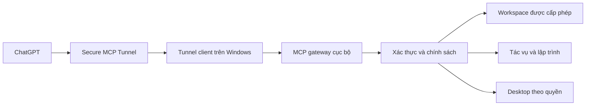
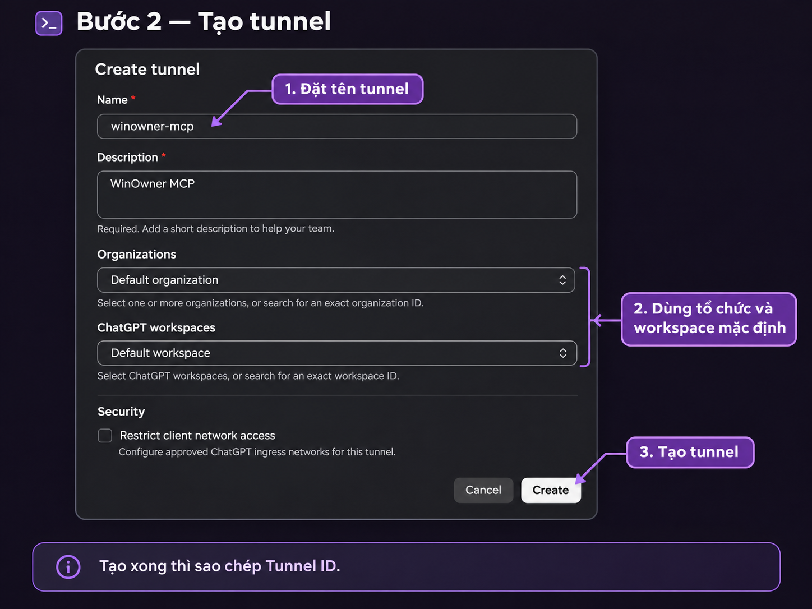

<div align="center">

# WinOwner MCP v1.2.0

**Không gian làm việc Windows của bạn, ngay trong ChatGPT.**

MCP gateway mã nguồn mở cho Windows, hỗ trợ kiểm tra workspace, quy trình lập trình có kiểm soát và quản lý tác vụ theo đúng quyền được cấp.

Windows 10/11 · Model Context Protocol · MIT

[English](README.md) | **Tiếng Việt**

[Tổng quan](#tổng-quan) · [Tính năng](#tính-năng-chính) · [Kiến trúc](#kiến-trúc) · [Bắt đầu nhanh](#bắt-đầu-nhanh) · [34 công cụ](docs/CAPABILITIES.md) · [Bảo mật & Phân quyền](#bảo-mật--phân-quyền) · [Xử lý sự cố](#xử-lý-sự-cố)

</div>

## Tổng quan

WinOwner MCP kết nối máy Windows của chính bạn với ChatGPT thông qua tunnel riêng có xác thực, thay vì đẩy dữ liệu lên máy ảo đám mây. MCP gateway cục bộ chỉ lắng nghe trên loopback (`127.0.0.1:8768`), kiểm tra xác thực và chính sách trên từng yêu cầu, mặc định chế độ `read_only`, đồng thời giữ nguyên ranh giới phân quyền NTFS và phiên Windows.

## Tính năng chính

| Tính năng | Lợi ích mang lại |
|---|---|
| Cài đặt chuẩn Windows | Một lệnh cài (`go.ps1`) hoặc giải nén ZIP (`Install-WinOwner.cmd`), tự động kiểm tra dịch vụ và xác thực cục bộ |
| Kiểm tra workspace & Git | Đọc thư mục được cấp phép, xem tệp văn bản, kiểm tra `git status` và `git diff` |
| Quy trình lập trình có phạm vi | Chỉnh sửa tệp, chạy kiểm thử và lệnh trong phạm vi đã được phê duyệt rõ ràng |
| Quản lý vòng đời tác vụ | Xem trạng thái, nhật ký, diff, artifact; tạm dừng, tiếp tục, hủy và dừng khẩn cấp khi có xác thực owner |
| Ranh giới thao tác Desktop | Quan sát màn hình, chụp ảnh, thao tác chuột/phím bị giới hạn nghiêm ngặt theo danh tính owner, chính sách và phiên Windows |
| Tiện ích vòng đời kết nối | Tự chẩn đoán (`Check-WinOwner.cmd`), cấu hình/ngắt tunnel (`Connect-ChatGPT.cmd`, `Disconnect-ChatGPT.cmd`) và gỡ cài đặt sạch |

## Kiến trúc



- Gateway cục bộ chỉ bind `127.0.0.1`, không thiết kế để mở trực tiếp ra mạng công cộng.
- Kết nối sử dụng HTTPS đi ra thông qua `tunnel-client` chính thức của OpenAI (được tải và kiểm tra SHA-256 trong `Connect-ChatGPT.cmd`).
- WinOwner chạy dưới phiên người dùng Windows hiện tại, không tự động nâng quyền Administrator và không vượt qua NTFS/UAC.

## Yêu cầu hệ thống

- Windows 10 hoặc Windows 11 (x64) và Windows PowerShell 5.1.
- Python 3.12 (bộ cài có thể cài tự động qua `winget` nếu hỗ trợ, hoặc cài thủ công từ python.org).
- Kết nối Internet đi ra, tài khoản/workspace ChatGPT đủ quyền thêm custom MCP server và quyền OpenAI Platform để tạo Runtime API key và Tunnel.
- Phiên người dùng Windows đang hoạt động; các công cụ tương tác Desktop đòi hỏi phiên màn hình đang mở khóa.

## Bắt đầu nhanh

### Cài đặt cục bộ

> Phiên bản `v1.2.0` chưa được phát hành chính thức. Chỉ chạy lệnh dưới đây sau khi xác nhận tag `v1.2.0` đã xuất hiện trên [GitHub Releases](https://github.com/phuonghuster7/winowner-mcp/releases).

Mở Command Prompt (**CMD**) trên Windows khi `v1.2.0` đã phát hành (hoặc giải nén gói ZIP phát hành và nhấp đúp `Install-WinOwner.cmd`):

```cmd
powershell -NoP -C "irm https://github.com/phuonghuster7/winowner-mcp/raw/v1.2.0/go.ps1|iex"
```

Mặc định, WinOwner cài đặt vào `%LOCALAPPDATA%\WinOwnerMCP\v1.2.0` ở chế độ `read_only`, tạo môi trường `.venv` riêng, đăng ký tác vụ Task Scheduler theo người dùng hiện tại, rồi tự kiểm tra `/health` và chặn truy cập ẩn danh HTTP `401` (`LOCAL_INSTALL_PASS`).

### Kết nối ChatGPT

Sử dụng đúng OpenAI organization và ChatGPT workspace được cấp phép. Bốn hình dưới đây là minh họa đã ẩn định danh cá nhân (`Thông tin riêng đã ẩn`), không phải ảnh chụp trực tiếp tài khoản thật.

#### Bước 1 · Tạo Runtime API key

[Trang OpenAI API keys](https://platform.openai.com/settings/organization/api-keys) · [Hướng dẫn Secure MCP Tunnels chính thức](https://developers.openai.com/api/docs/guides/secure-mcp-tunnels)


1. **Nhập tên API key:** đặt tên dễ nhận biết như `WinOwner MCP Runtime`.
2. **Kiểm tra quyền:** chọn **Restricted** và chỉ cấp quyền cần thiết cho tunnel—không cấp quyền quản trị dư thừa cho khóa runtime.
3. **Tạo khóa:** bấm **Create secret key** và lưu trữ an toàn. Tuyệt đối không dán khóa vào khung chat, Git hoặc ảnh chụp màn hình.

#### Bước 2 · Tạo Tunnel riêng

[Trang OpenAI Tunnels](https://platform.openai.com/settings/organization/tunnels) · [Tài liệu tunnel-client chính thức](https://github.com/openai/tunnel-client/blob/master/docs/end-user-guide.md)



1. **Tên tunnel:** nhập `Winowner-mcp` (hoặc tên định danh phù hợp).
2. **Mô tả:** điền mô tả ngắn gọn, ví dụ `winowner mcp`.
3. **Tổ chức:** chọn OpenAI organization bạn có quyền sử dụng.
4. **Workspace:** chọn ChatGPT workspace tương ứng nếu hiển thị.
5. **Tạo tunnel:** bấm **Create** và lưu lại `Tunnel ID` (`tunnel_...`).

Tiếp theo, chạy `Connect-ChatGPT.cmd` trong `%LOCALAPPDATA%\WinOwnerMCP\v1.2.0` và nhập Runtime API key (ô nhập ẩn) cùng `Tunnel ID`. Runtime API key dùng để xác thực `tunnel-client`, còn `Tunnel ID` định danh đường kết nối.

#### Bước 3 · Tạo Plugin trong ChatGPT

[Trang plugin ChatGPT](https://chatgpt.com/plugins) · [Hướng dẫn Secure MCP Tunnels chính thức](https://developers.openai.com/api/docs/guides/secure-mcp-tunnels) · [Giải thích Authentication None](docs/AUTH_NONE.vi.md)


1. **Tên plugin:** nhập `Winowner-mcp`.
2. **Connection:** chọn chế độ **Tunnel**.
3. **Tunnel ID:** nhập `Tunnel ID` đã tạo ở Bước 2.
4. **Xác thực:** thiết lập khớp với cấu hình server đã xác minh (`No authentication` chỉ dùng ở giao diện plugin khi WinOwner bảo vệ tầng tunnel riêng và backend; tùy chọn này không bỏ qua kiểm tra HTTP `401` phía máy và không cấp quyền owner).
5. **Hoàn tất:** đọc cảnh báo rủi ro, đánh dấu xác nhận và bấm **Create as a plugin**. Giữ quyền ban đầu ở mức `read_only`.

#### Bước 4 · Quyền Plugin (tùy chọn)

[Tài liệu quản lý quyền ứng dụng trong ChatGPT](https://help.openai.com/en/articles/20001495-managing-app-permissions-in-chatgpt)


Bước này là **tùy chọn và không bắt buộc để kết nối**.

1. **Quyền phê duyệt:** quy định khi nào ChatGPT hiển thị hộp thoại hỏi ý kiến người dùng trước khi gọi tool.
2. **Khuyến nghị — chỉ đọc (`Allow read-only tools`):** cho phép đọc và luôn hỏi lại trước khi sửa đổi dữ liệu.
3. **`Allow all tools`:** bỏ qua lời nhắc xác nhận trên giao diện ChatGPT, mang rủi ro cao và **không cấp quyền owner**. Nên giữ xác nhận với thao tác nhạy cảm.

**Phê duyệt của ChatGPT và quyền của backend là hai lớp độc lập:** thiết lập trên ChatGPT chỉ kiểm soát việc hỏi xác nhận ở giao diện chat. Backend WinOwner và Windows tự kiểm tra độc lập danh tính, OAuth owner delegation, capability grant và chính sách workspace trên từng request. Chọn `Allow all tools` không thể vượt qua kiểm tra phía backend.

### Kiểm tra kết nối

| Kết quả | Phạm vi đã xác minh |
|---|---|
| `LOCAL_INSTALL_PASS` / `CHECK_PASS` | Dịch vụ MCP cục bộ chạy ổn định và chặn ẩn danh HTTP `401` |
| `TUNNEL_SETUP_PASS` / `TUNNEL_READY` | Tác vụ `tunnel-client` cục bộ đang chạy và `/readyz` phản hồi sẵn sàng |
| ChatGPT gọi thành công tác vụ đọc thử | Xác nhận thực thi đầu-cuối cho workspace ChatGPT và yêu cầu cụ thể đó |

Ba mức kiểm tra này độc lập với nhau. Luôn kiểm thử bằng tác vụ chỉ đọc an toàn trên workspace kiểm thử trước khi cấp thêm quyền ghi hoặc quyền owner.

## Ví dụ sử dụng

Sau khi kết nối, hãy thử trước các câu lệnh chỉ đọc trong một workspace kiểm thử đã được phê duyệt:

- `"Liệt kê các workspace đã được phê duyệt."`
- `"Tóm tắt trạng thái Git của dự án được cấp phép mà không sửa bất kỳ tệp nào."`
- `"Hiển thị trạng thái tác vụ hiện có."`

Cấu trúc phản hồi chỉ đọc minh họa:

```text
Approved workspaces:
- D:\SampleWorkspace (read_only)

Git status summary:
- branch: feat/example
- modified files: 0
- untracked files: 0

Task status:
- no active mutating tasks
```

*Chỉ là ví dụ dữ liệu giả để minh họa cấu trúc phản hồi, không phải ảnh/video hay kết quả nghiệm thu thực tế.*

## Danh mục chức năng — 34 công cụ

Danh mục cloud bao gồm **14 tool cơ bản** và **20 tool thuộc danh mục owner** (**tổng 34 mục trong danh mục**). WinOwner mặc định `read_only`; một tool xuất hiện trong danh mục không đồng nghĩa đã được cấp quyền thực thi.

| Nhóm chức năng | Cơ bản | Danh mục owner | Giới hạn truy cập & an toàn |
|---|---:|---:|---|
| Đọc workspace & Git | 4 | 0 | Đọc thư mục được duyệt và thông tin Git |
| Thay đổi tệp & thư mục | 2 | 6 | Quyền ghi theo phạm vi (`read_only` chặn ghi nếu chưa có grant hợp lệ) |
| Lập trình & chạy kiểm thử | 2 | 0 | Cần cấp quyền thực thi riêng; không phải sandbox hệ điều hành |
| Gửi & theo dõi tác vụ | 6 | 0 | Gửi tác vụ không đồng nghĩa tự động thực thi |
| Điều phối vòng đời tác vụ | 0 | 4 | Tạm dừng, tiếp tục, hủy và dừng khẩn cấp cần xác thực owner |
| Quan sát & tương tác Desktop | 0 | 9 | Chỉ owner xác thực; chịu giới hạn phiên Windows và chính sách |
| Thực thi hệ thống | 0 | 1 | `agent_powershell_execute`; kiểm tra quyền owner nghiêm ngặt & ACL Windows |
| **Tổng cộng** | **14** | **20** | **34 mục danh mục — không phải 34 quyền bật sẵn** |

Xem chi tiết 34 định danh tool và mô hình phân tầng quyền tại [docs/CAPABILITIES.md](docs/CAPABILITIES.md).

## Bảo mật & Phân quyền

WinOwner tách biệt cơ chế bảo vệ thành 3 lớp kiểm tra độc lập:

1. **Quyền phê duyệt trên ChatGPT (lớp giao diện):** kiểm soát khi nào ChatGPT hỏi trước lúc gọi tool (`Always ask`, `Allow read-only tools`, `Allow all tools`). Đây là tùy chọn giao diện, không có hiệu lực cấp quyền trên máy Windows.
2. **Xác thực và chính sách backend WinOwner (lớp gateway):** bắt buộc có thông tin xác thực caller/tunnel hợp lệ, mặc định `read_only`, tách biệt xác thực chủ máy OAuth (`Grant-OwnerAccess.cmd`) khỏi khóa tunnel dùng chung, đồng thời kiểm tra phạm vi đường dẫn và capability grant ở mọi lượt gọi tool.
3. **Kiểm soát của hệ điều hành Windows (lớp OS):** tiến trình chạy dưới tài khoản người dùng chuẩn; quyền NTFS và UAC của Windows luôn có hiệu lực.

Các tiện ích quản trị cục bộ trong `%LOCALAPPDATA%\WinOwnerMCP\v1.2.0`:

- `Check-WinOwner.cmd`: kiểm tra dịch vụ cục bộ, chặn ẩn danh HTTP `401` và trạng thái sẵn sàng của tunnel.
- `Disconnect-ChatGPT.cmd`: dừng và gỡ tác vụ tunnel cục bộ đã xác minh nhưng vẫn giữ nguyên dịch vụ và cấu hình cài đặt.
- `Uninstall-WinOwner.cmd`: dừng và gỡ sạch dịch vụ MCP cùng tác vụ tunnel đã xác minh.
- [Quản trị nâng cao](docs/ADVANCED_CHATGPT.vi.md): `Grant-OwnerAccess.cmd`, `Show-OwnerKey.cmd` và `Revoke-OwnerAccess.cmd` là các công cụ quản trị riêng cho chủ máy, tách khỏi bước cài đặt ban đầu.

Xem thêm [SECURITY.md](SECURITY.md), [docs/INSTALLATION.md](docs/INSTALLATION.md) và [docs/START_HERE.vi.md](docs/START_HERE.vi.md).

## Xử lý sự cố

| Triệu chứng | Hướng kiểm tra |
|---|---|
| Cài đặt cục bộ báo lỗi | Xem `WinOwner-SETUP-RESULT.txt`, chạy lại `Check-WinOwner.cmd`, kiểm tra Python 3.12 và cổng `8768` |
| Báo lỗi HTTP `401` | Đảm bảo đã chạy `Connect-ChatGPT.cmd` với Runtime API key và Tunnel ID hợp lệ; không tắt xác thực backend |
| Tunnel chưa sẵn sàng / `429` | Kiểm tra tiến trình `tunnel-client`, mạng đi ra và giới hạn tần suất qua `Check-WinOwner.cmd` |
| Tool bị từ chối quyền | Kiểm tra phạm vi workspace, chế độ `read_only` hoặc capability grant; không tự hạ chuẩn xác thực |
| Cần ngắt kết nối khẩn cấp | Chạy `Disconnect-ChatGPT.cmd` hoặc kích hoạt dừng khẩn cấp và thu hồi grant riêng |

Chi tiết các bước khắc phục xem tại [docs/TROUBLESHOOTING.md](docs/TROUBLESHOOTING.md).

## Giấy phép

Phát hành theo giấy phép [MIT](LICENSE).

- [Bản phát hành](https://github.com/phuonghuster7/winowner-mcp/releases) · [Lịch sử CI](https://github.com/phuonghuster7/winowner-mcp/actions) · [Hướng dẫn đóng góp](CONTRIBUTING.md)
- CI tự động kiểm tra mã nguồn sạch, quét bảo mật tĩnh, đóng gói ZIP và chạy thử cục bộ; CI không thay thế cho việc nghiệm thu ghép nối ChatGPT thực tế, độ tương thích trên mọi máy hay chứng nhận an toàn.
- Dự án mã nguồn mở độc lập, không trực thuộc OpenAI hay Microsoft.
