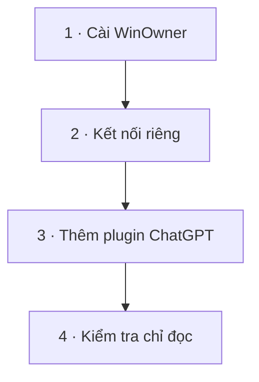

# WinOwner MCP v1.2.0

Kết nối máy Windows 10/11 của bạn với ChatGPT để thực hiện tác vụ đọc đã được cho phép.

[English](README.md) · [Hướng dẫn kỹ thuật](docs/ADVANCED_CHATGPT.vi.md)



## 1. Cài đặt
Kiểm tra [Releases](https://github.com/phuonghuster7/winowner-mcp/releases). Lệnh bên dưới cần tag v1.2.0; kiểm tra nguồn bộ cài trước khi chạy trong CMD.
```cmd
powershell -NoP -C "irm https://github.com/phuonghuster7/winowner-mcp/raw/v1.2.0/go.ps1|iex"
```
Mở thư mục `%LOCALAPPDATA%\WinOwnerMCP\v1.2.0`, chạy `Check-WinOwner.cmd`.

## 2. Kết nối riêng
Xem [hướng dẫn Secure MCP Tunnel chính thức](https://developers.openai.com/api/docs/guides/secure-mcp-tunnels). Cần phân biệt **Tunnel ID** (mã đường kết nối) và **runtime API key** (khóa xác thực). Tiện ích cấu hình hiện có: `Connect-ChatGPT.cmd`. Không gửi khóa qua chat.

## 3. Tạo plugin ChatGPT
Xem [hướng dẫn tạo plugin của OpenAI](https://developers.openai.com/api/docs/guides/custom-mcp-server). Kiểm tra quyền được yêu cầu, giữ chế độ chỉ đọc ban đầu. Authentication không thay thế xác minh chủ máy.

## 4. Kiểm tra kết nối
Máy hoạt động ≠ tunnel sẵn sàng ≠ ChatGPT kết nối thành công. Kiểm tra bằng một tác vụ đọc không nhạy cảm.

## Quản lý
- `Disconnect-ChatGPT.cmd`: ngắt tunnel đã xác minh.
- `Uninstall-WinOwner.cmd`: dừng và gỡ dịch vụ.
- [Quản trị nâng cao](docs/ADVANCED_CHATGPT.vi.md): Show-OwnerKey và các tiện ích quản trị không thuộc luồng cài đặt ban đầu. Ghép nối owner và thu hồi quyền cần nghiệm thu riêng.

[Hướng dẫn người mới](docs/START_HERE.vi.md) · [Cài đặt và sửa lỗi](docs/INSTALLATION.md) · [Bảo mật](SECURITY.md)

MIT · Dự án độc lập với OpenAI và Microsoft.
