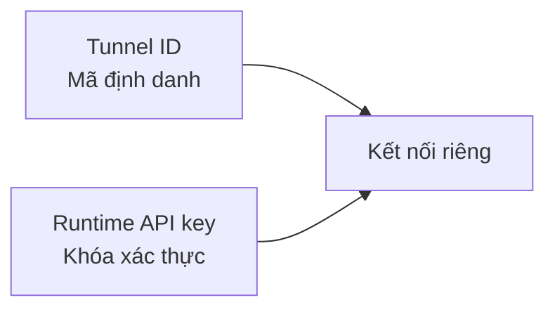
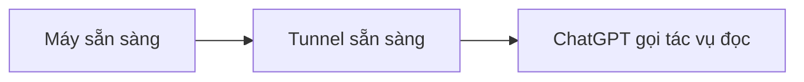

# WinOwner MCP — bắt đầu

**Bản v1.2.0 đang phát triển, chưa được phát hành chính thức.**

## 1. Cài đặt

Sau khi v1.2.0 được phát hành và xác minh, mở CMD, kiểm tra nguồn bộ cài rồi dùng lệnh được công bố:

```cmd
powershell -NoP -C "irm https://github.com/phuonghuster7/winowner-mcp/raw/v1.2.0/go.ps1|iex"
```

Nhấn **Win + R**, mở thư mục `%LOCALAPPDATA%\WinOwnerMCP\v1.2.0`.

Chạy `Check-WinOwner.cmd`. **THÀNH CÔNG**: dịch vụ trên máy sẵn sàng. **THẤT BẠI**: xem thông báo lỗi. Không cần tắt phần mềm bảo mật.

## 2. Kết nối riêng

Đọc [hướng dẫn Secure MCP Tunnel của OpenAI](https://developers.openai.com/api/docs/guides/secure-mcp-tunnels). Chỉ sử dụng tài khoản và workspace được phép kết nối.



*Hình trên là sơ đồ minh họa, không phải ảnh chụp giao diện.*

Hai giá trị này có mục đích khác nhau; không phải hai API key. Tiện ích hiện có là `Connect-ChatGPT.cmd`. Không chia sẻ khóa hoặc ảnh màn hình chứa khóa.

## 3. Plugin ChatGPT

Xem [hướng dẫn thêm custom MCP server của OpenAI](https://developers.openai.com/api/docs/guides/custom-mcp-server). Kiểm tra thông tin plugin và quyền truy cập được yêu cầu. Giữ chế độ chỉ đọc để nghiệm thu.

Authentication None không có nghĩa là bỏ xác thực phía máy; HTTP 401 có thể xuất hiện khi chưa được cấp quyền. Ghép nối owner qua OAuth là luồng riêng, chưa nghiệm thu thực tế.

## 4. Kiểm tra kết nối

| Kết quả | Ý nghĩa |
|---|---|
| CHECK_PASS | Máy Windows sẵn sàng |
| TUNNEL_READY | Đường kết nối sẵn sàng |
| ChatGPT trả kết quả từ tác vụ đọc thử | Kết nối được kiểm tra thực tế |



## Ngắt kết nối

`Disconnect-ChatGPT.cmd` ngắt tunnel cục bộ; `Uninstall-WinOwner.cmd` dừng và gỡ dịch vụ đã xác minh. Thu hồi quyền từ tài khoản riêng khi cần. Không tự chuyển Full Control chỉ để sửa lỗi kết nối.

[Tài liệu kỹ thuật](ADVANCED_CHATGPT.vi.md) · [Sửa lỗi](TROUBLESHOOTING.md) · [Bảo mật](../SECURITY.md)
