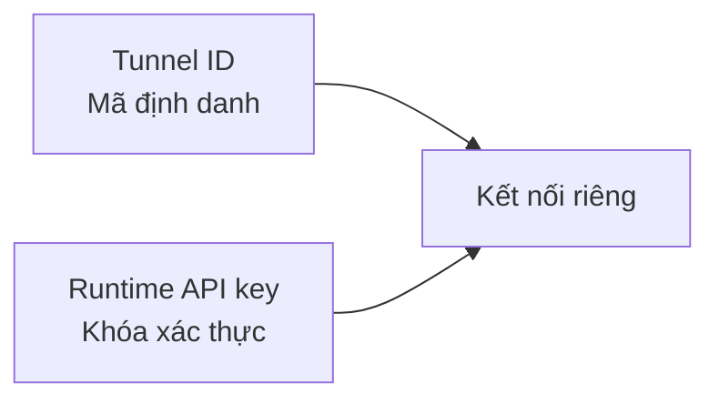
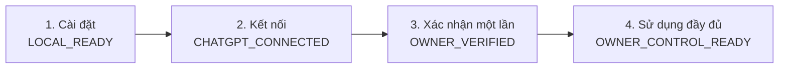

# WinOwner MCP — bắt đầu

[English](../README.md) | **Tiếng Việt**

## 1. Cài đặt

v1.2.0 chưa được phát hành. Chỉ chạy lệnh dưới đây sau khi xác nhận bản phát hành v1.2.0 đã có trên [GitHub Releases](https://github.com/phuonghuster7/winowner-mcp/releases). Khi đó, mở CMD:

```cmd
powershell -NoP -C "irm https://github.com/phuonghuster7/winowner-mcp/raw/v1.2.0/go.ps1|iex"
```

**THÀNH CÔNG**: bộ cài đã tự kiểm tra dịch vụ và xác thực trên máy. **THẤT BẠI**: xem thông báo lỗi. Không tắt phần mềm bảo mật.

Ghi chú: lệnh chỉ hoạt động sau khi tag v1.2.0 được phát hành.

## 2. Kết nối riêng

[Xem hình minh họa và liên kết trong README tiếng Việt](../README.vi.md#kết-nối-chatgpt).

Đọc [hướng dẫn Secure MCP Tunnel của OpenAI](https://developers.openai.com/api/docs/guides/secure-mcp-tunnels). Chỉ sử dụng tài khoản và workspace được phép kết nối.



*Hình trên là sơ đồ minh họa, không phải ảnh chụp giao diện.*

Hai giá trị này có mục đích khác nhau; không phải hai API key. Tiện ích hiện có là `Connect-ChatGPT.cmd`. Không chia sẻ khóa hoặc ảnh màn hình chứa khóa.

## 3. Plugin ChatGPT & WinOwner Setup Center

Xem [hướng dẫn thêm custom MCP server của OpenAI](https://developers.openai.com/api/docs/guides/custom-mcp-server). Kiểm tra thông tin plugin và quyền truy cập được yêu cầu. Giữ chế độ chỉ đọc (`read_only`) để nghiệm thu bước đầu.

Authentication None không có nghĩa là bỏ xác thực phía máy; HTTP 401 có thể xuất hiện khi chưa được cấp quyền. Vì `Authentication: None` qua tunnel không mang danh tính client riêng nên luôn giới hạn ở chế độ chỉ đọc (`Read`). Để nâng lên quyền chủ máy (`Scoped` / `Owner`), ghép nối OAuth 2.1 rồi nhấp đúp `Open-SetupCenter.cmd` (tự động đăng nhập theo người dùng Windows, không cần nhập Admin Key) và bấm một nút **"Xác nhận cấp quyền chủ máy"** trong **WinOwner Setup Center** (hoặc `Grant-OwnerAccess.cmd`) — phiên đã duyệt tự duy trì qua các lần khởi động lại cho tới khi hết hạn hoặc bị thu hồi.

## 4. Quyền plugin (tùy chọn)

`Allow all tools` giảm yêu cầu xác nhận nhưng tăng rủi ro, không cấp quyền owner và không bắt buộc để kết nối. Giữ xác nhận cho thao tác nhạy cảm.

## 5. Hành trình 4 bước & Kiểm tra kết nối

| Bước / Kết quả | Ý nghĩa xác minh thực tế |
|---|---|
| `LOCAL_READY` (`LOCAL_INSTALL_PASS` / `CHECK_PASS`) | Dịch vụ và chặn ẩn danh HTTP 401 cục bộ sẵn sàng |
| `TUNNEL_READY` (`TUNNEL_SETUP_PASS`) | Tunnel sẵn sàng tại máy (chưa tính là đã nối ChatGPT) |
| `CHATGPT_CONNECTED` | ChatGPT gọi thành công công cụ chỉ đọc thật |
| `OWNER_VERIFIED` -> `OWNER_CONTROL_READY` | Chủ máy phê duyệt yêu cầu ghép nối OAuth 2.1 một lần trên máy |



## Xử lý sự cố và ngắt kết nối

Nhấn **Win + R**, mở `%LOCALAPPDATA%\WinOwnerMCP\v1.2.0` rồi dùng `Open-SetupCenter.cmd` để mở giao diện Setup Center (hoặc `Check-WinOwner.cmd` để kiểm tra nhanh).

`Disconnect-ChatGPT.cmd` ngắt tunnel cục bộ; `Uninstall-WinOwner.cmd` dừng và gỡ dịch vụ đã xác minh. Thu hồi quyền bất cứ lúc nào trong Setup Center hoặc `Revoke-OwnerAccess.cmd`. Không tự chuyển Full Control chỉ để sửa lỗi kết nối.

[Tài liệu kỹ thuật](ADVANCED_CHATGPT.vi.md) · [Sửa lỗi](TROUBLESHOOTING.md) · [Bảo mật](../SECURITY.md)
