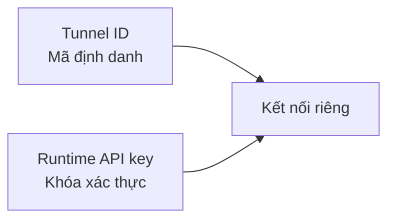
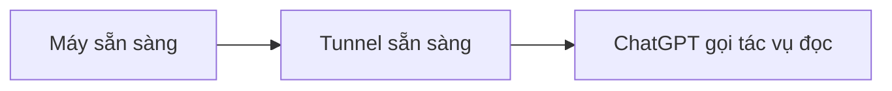

# WinOwner MCP — bắt đầu

[English](../README.md) | **Tiếng Việt**

## 1. Cài đặt

Mở CMD khi bản phát hành tương ứng đã sẵn sàng.

```cmd
powershell -NoP -C "irm https://github.com/phuonghuster7/winowner-mcp/raw/v1.2.0/go.ps1|iex"
```

**THÀNH CÔNG**: bộ cài đã tự kiểm tra dịch vụ và xác thực trên máy. **THẤT BẠI**: xem thông báo lỗi. Không tắt phần mềm bảo mật.

Ghi chú: lệnh chỉ hoạt động sau khi tag v1.2.0 được phát hành.

## 2. Kết nối riêng

[Xem hình minh họa và liên kết trong README tiếng Việt](../README.vi.md#kết-nối-chatgpt).

Đọc [hướng dẫn Secure MCP Tunnel của OpenAI](https://developers.openai.com/api/docs/guides/secure-mcp-tunnels). Chỉ sử dụng tài khoản và workspace được phép kết nối.



*Hình trên là sơ đồ minh họa, không phải ảnh chụp giao diện.*

Hai giá trị này có mục đích khác nhau; không phải hai API key. Tiện ích hiện có là `Connect-ChatGPT.cmd`. Không chia sẻ khóa hoặc ảnh màn hình chứa khóa.

## 3. Plugin ChatGPT

Xem [hướng dẫn thêm custom MCP server của OpenAI](https://developers.openai.com/api/docs/guides/custom-mcp-server). Kiểm tra thông tin plugin và quyền truy cập được yêu cầu. Giữ chế độ chỉ đọc để nghiệm thu.

Authentication None không có nghĩa là bỏ xác thực phía máy; HTTP 401 có thể xuất hiện khi chưa được cấp quyền. Ghép nối owner qua OAuth là luồng riêng, chưa nghiệm thu thực tế.

## 4. Quyền plugin (tùy chọn)

`Allow all tools` giảm yêu cầu xác nhận nhưng tăng rủi ro, không cấp quyền owner và không bắt buộc để kết nối. Giữ xác nhận cho thao tác nhạy cảm.

## 5. Kiểm tra kết nối

| Kết quả | Ý nghĩa |
|---|---|
| LOCAL_INSTALL_PASS / CHECK_PASS | Dịch vụ và xác thực cục bộ |
| TUNNEL_SETUP_PASS / TUNNEL_READY | Tunnel sẵn sàng tại máy |
| ChatGPT trả kết quả từ tác vụ đọc thử | Kết nối được kiểm tra thực tế |



## Xử lý sự cố và ngắt kết nối

Chỉ khi cần kiểm tra lỗi dịch vụ: nhấn **Win + R**, mở `%LOCALAPPDATA%\WinOwnerMCP\v1.2.0` rồi dùng `Check-WinOwner.cmd`.

`Disconnect-ChatGPT.cmd` ngắt tunnel cục bộ; `Uninstall-WinOwner.cmd` dừng và gỡ dịch vụ đã xác minh. Thu hồi quyền từ tài khoản riêng khi cần. Không tự chuyển Full Control chỉ để sửa lỗi kết nối.

[Tài liệu kỹ thuật](ADVANCED_CHATGPT.vi.md) · [Sửa lỗi](TROUBLESHOOTING.md) · [Bảo mật](../SECURITY.md)
